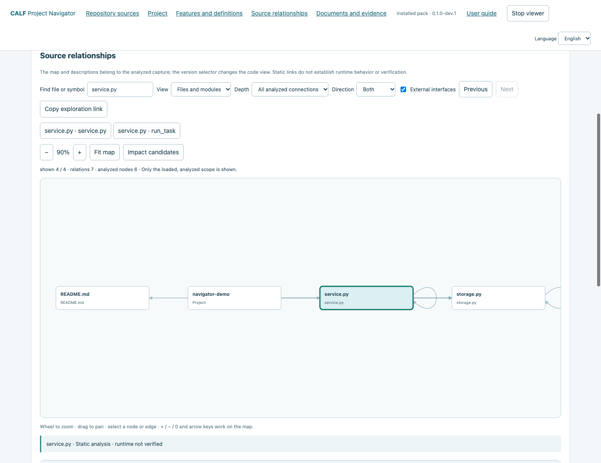
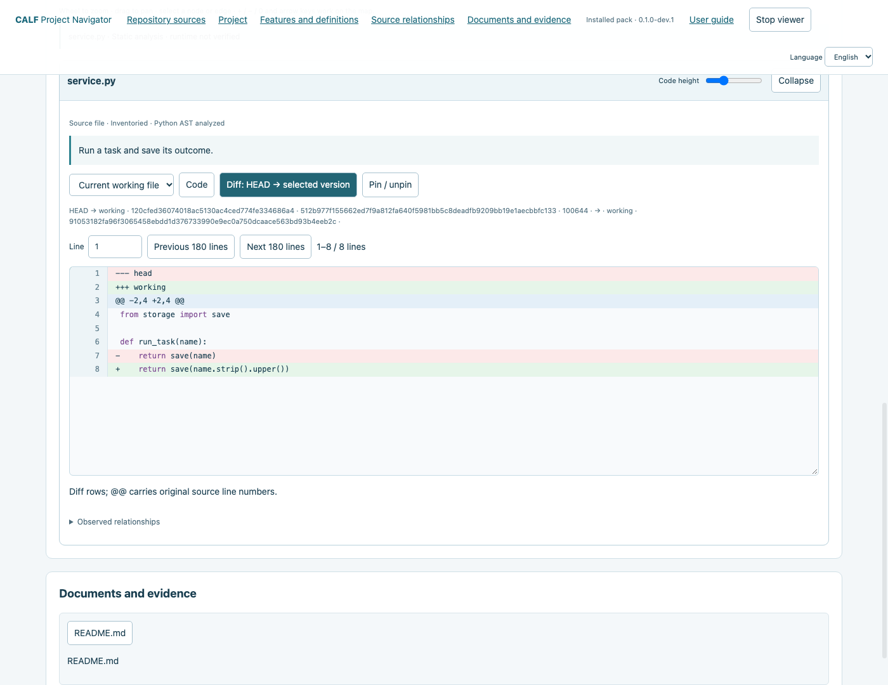
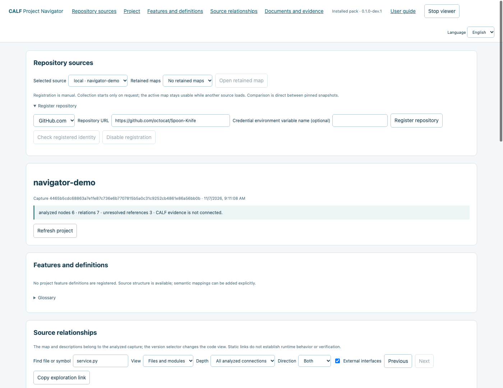
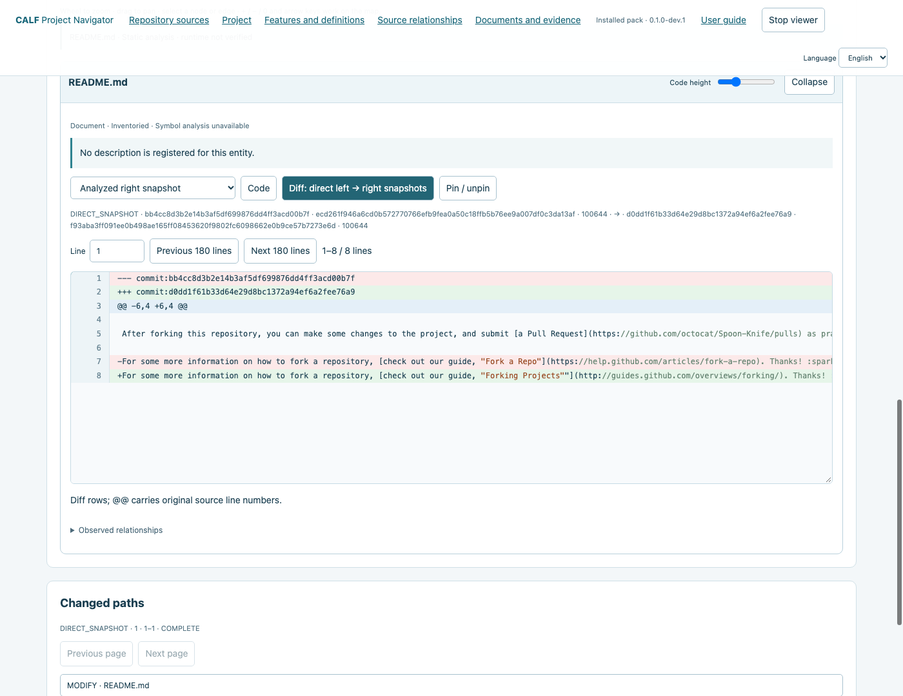
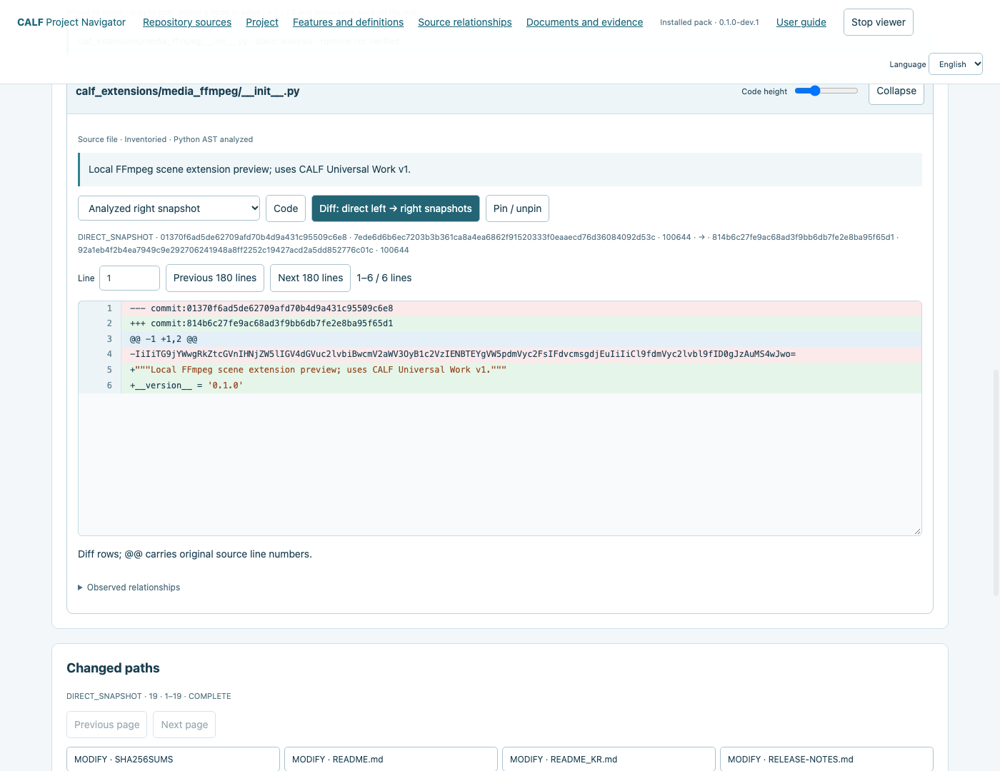
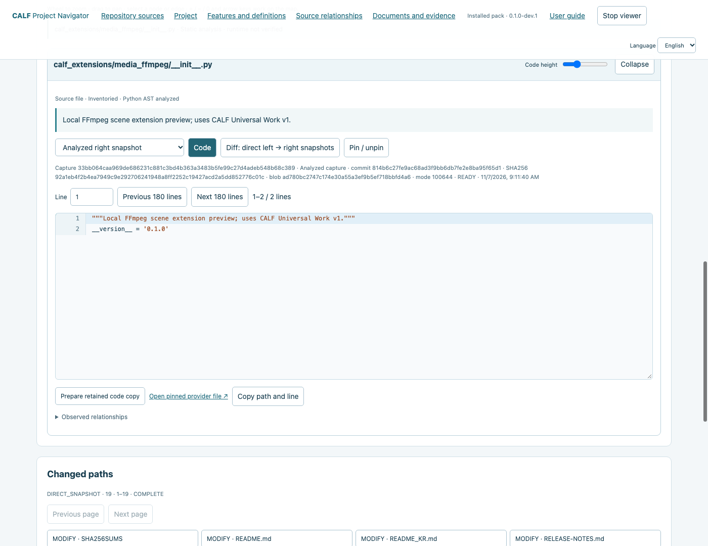

# CALF Extensions

**Repository Navigator:** [Screenshot manual](#project-navigation-preview) · [English PDF](https://github.com/VibePakcr/CALF-Extensions/releases/download/navigator-v0.1.0-dev.1/CALF-Repository-Navigator-Guide-en.pdf) · [한국어 PDF](https://gitlab.com/vibepackr-group/CALF-Extensions/-/releases/navigator-v0.1.0-dev.1/downloads/CALF-Repository-Navigator-Guide-ko.pdf)

## Local packs preview

**Local Pack Tools + Repository Pack 0.1.0-preview.1** now have verified install, update and recovery on macOS, Windows and Linux. [Download and verification](https://github.com/VibePakcr/CALF-Extensions/releases/tag/packs-v0.1.0-preview.1) · [English guide](docs/PACKS_GUIDE.md) · [한국어 안내](docs/PACKS_GUIDE_KR.md). This read-only local mode needs Python and Git, with no model or native core required.


[한국어](README_KR.md) · [CALF downloads](https://github.com/VibePakcr/CALF/blob/main/DOWNLOADS.md) · [License](LICENSE-EXTENSIONS.txt)

Small, local extensions for **CALF — Controlled Agent Lifecycle Framework**. Connect a runtime to CALF's work contracts, independent checks and version-bound evidence without modifying the proprietary core.

**0.1.0 developer preview:** [Download](https://github.com/VibePakcr/CALF-Extensions/releases/tag/v0.1.0) · [GitLab](https://gitlab.com/vibepackr-group/CALF-Extensions/-/releases/ffmpeg-v0.1.0) · [Release notes](RELEASE-NOTES.md). One portable Python package supports the tested macOS, Windows and Linux environments. It is separate from the native CALF installer.

The first extension is a **local FFmpeg scene workflow**, available here as a developer preview. It addresses a common production problem: **change scene 3 while keeping approved scenes 1 and 2 unchanged**.

## What works in this preview

- Render one MP4 candidate for one scene, using installed FFmpeg.
- Check it independently with ffprobe and a complete decode. Check black frames and silence when required by the contract.
- Bind the scene, project version, media hash and validation receipt before adoption.
- Select only the requested scene's validated version. Retain earlier approved files and selection manifests.
- Reject stale evidence, conflicting request keys and adoption against a changed project.
- Restore a retained, validated scene version by selection, without rendering other scenes.

The extension does not call an AI, download tools, start a daemon or load media histories into memory. Media is streamed in 32 KiB chunks for hashing/copying; execution and diagnostics have explicit limits.

## Start here

1. Install [CALF Harness or Workbench](https://github.com/VibePakcr/CALF/blob/main/DOWNLOADS.md) and obtain the separate [CALF SDK 0.2.1](https://github.com/VibePakcr/CALF/releases/tag/sdk-v0.2.1).
2. Install Python 3.10+ and your own FFmpeg/ffprobe with `libx264`, AAC, `blackdetect` and `silencedetect` support. This repository does not bundle them.
3. Follow the [FFmpeg guide](docs/FFMPEG.md). Start with new records and a new scene project before connecting existing work.

The extension uses only Python's standard library and the CALF SDK. The SDK and native runtime are separate dependencies; neither is copied into this repository.

## Agent integration

The work contract is independent of the model. Codex, Antigravity, Claude or another client can use the CLI/SDK from an authorized host. CALF's existing stdio Work MCP can expose recorded evidence to any compatible MCP client. See [agent and MCP integration](docs/AGENTS.md).

**Claude Code 2.1.201 was tested with a real model:** inspect → execute once → inspect, followed by native evidence verification and host-authorized scene selection. The [Claude guide](docs/CLAUDE.md) and [bounded example](examples/claude_work.py) wait for MCP to connect before sending a model request. The scene-selection API, not an agent's completion statement, determines which version is selected.

Approved files are never overwritten by this extension. Read-only file permissions and hashes help protect and detect changes, but they are not an OS sandbox. A separate process with filesystem rights can still modify files outside the controlled path; those rights must be restricted by its host if prevention is required.

## Verified scope

The [verification summary](VERIFICATION.json) records the tools, native cores and scenarios. Short synthetic MP4 tests passed **13 acceptance groups on each of macOS ARM64, Windows 11 x64 and Debian 13 x64**. These groups include three contract unit tests. Harness 1.8.7 and Workbench 1.9.2 native cores read the same records. Tested FFmpeg versions were 8.1.2, 9.0.2 and 7.0.2 respectively.

The live Claude Code workflow was tested on macOS. Claude Desktop GUI configuration, other OS/architecture combinations, production footage, longer jobs, aesthetic/semantic review, ComfyUI, Remotion, Veo, Runway and other generation APIs are **not qualified by these tests**. The reference architecture describes future extensions, not completed integrations.

## Project navigation preview

[GitHub download](https://github.com/VibePakcr/CALF-Extensions/releases/tag/navigator-v0.1.0-dev.1) · [GitLab download](https://gitlab.com/vibepackr-group/CALF-Extensions/-/releases/navigator-v0.1.0-dev.1) · [English PDF - 9 pages](https://github.com/VibePakcr/CALF-Extensions/releases/download/navigator-v0.1.0-dev.1/CALF-Repository-Navigator-Guide-en.pdf) · [한국어 PDF - 9쪽](https://gitlab.com/vibepackr-group/CALF-Extensions/-/releases/navigator-v0.1.0-dev.1/downloads/CALF-Repository-Navigator-Guide-ko.pdf)

### Illustrated user manual

The steps below are the complete nine-chapter user guide, with real screenshots from the installed preview. Source content, commit IDs and graph counts can vary with the selected repository and capture.

#### 1. Install and start

One free installed extension connects Local Git, GitHub.com and GitLab.com to a relationship map with descriptions, code and Diff below it.

1. Prepare Python 3.10+, Git 2.43+ and a modern browser. CALF core, SDK and models are not required.
2. Extract the trusted download into a new folder. Verify its published SHA256 and read the included license notices.
3. Open a terminal in the extracted folder and run the commands below. On Windows use python instead of python3.

```sh
python3 START_NAVIGATOR.py install --home ../navigator-store --data-dir ../navigator-data --preview
python3 START_NAVIGATOR.py open --home ../navigator-store
```

Installation runs offline fixture checks and records exact Python/Git identities. The browser opens automatically; keep its terminal running. Use Stop viewer to finish.

STORE, DATA and inspected repositories must be separate. No account discovery, global tool installation or background service is added.

Optional: select executables with --python ABSOLUTE_PATH --git ABSOLUTE_PATH. Add --no-browser to open to use the printed local URL manually.

#### 2. Attach Local Git and explore the map

1. Choose one existing worktree explicitly. Replace the example path with your actual project path.
2. Find a file or symbol, then select a node. Choose file/module or symbol view, incoming/outgoing/both, and depth 1/2/3/all analyzed connections.
3. Wheel to zoom, drag empty space to pan, or use + / - / Fit map. Previous/Next revisits selections; Impact candidates follows reverse static reachability.

```sh
python3 START_NAVIGATOR.py open --home ../navigator-store --repo /path/to/project
```



Only analyzed scope is shown, up to 500 displayed nodes. Static links and impact candidates do not prove runtime behavior.

Python symbols/calls are analyzed. Other languages retain file/document structure with coverage gaps shown.

#### 3. Read code and compare versions

1. Select a node and read its description, source and identities in the inspector below the map.
2. For Local Git choose analyzed capture, HEAD, index or working file. Diff compares HEAD to the selected version. Conflict stages 1/2/3 are separate states.
3. Use line navigation, code height, collapse and pin. Long lines scroll horizontally. Interface language changes do not translate source, comments or user definitions.



The navigator does not commit, checkout or alter source. A Local Git editor link opens its selected file path. Editing a working file in that editor changes the project; check path and version first.

#### 4. Register a GitHub repository

1. Expand Register repository, choose GitHub.com and enter https://github.com/octocat/Spoon-Knife or your own repository URL.
2. For public anonymous access leave the credential reference blank. Register, then Check registered identity. Registration is local and does not start collection.
3. Choose branch/tag/full commit and its exact name. This example uses branch + main. Choose a left ref or keep first parent/empty baseline, then Collect and analyze.



Anonymous API quotas apply. A limit, timeout or missing object can leave a partial result; this is not complete coverage. Cancel collection preserves the current map.

#### 5. Inspect pinned remote code and Diff

1. Select a file in the map, search results or Changed paths after collection.
2. Remote versions are analyzed right / comparison left / comparison right. Diff compares the pinned snapshots directly, not a working tree or merge base.
3. Read commit, blob and SHA256 identities. Open pinned provider file links to that commit. No remote branch or file is changed.



Absent files, empty files and unavailable source are distinct. Missing retained bytes are not presented as empty content.

#### 6. Use the same workflow with GitLab

1. Choose GitLab.com in Register repository. Public example: https://gitlab.com/vibepackr-group/CALF-Extensions
2. Register and check the project identity, then choose branch + main and Collect and analyze. Nested project namespaces are supported.
3. Map, source, direct Diff, changed paths and retained views use the same controls. Reads remain pinned to the resolved GitLab commit.



This preview targets GitHub.com and GitLab.com. Self-hosted servers and private-account behavior are not qualified by these public examples.

#### 7. Retained maps, definitions and editor copies

1. Choose a source, a Retained maps entry, then Open retained map. Reopening retained bytes does not re-collect a moving branch. Partial results require explicit selection.
2. For hosted source choose Code, then Prepare retained code copy. Its editor link points to a separate copy, not the cached original or remote file. VS Code needs a configured local URL handler.
3. Use an explicit UTF-8 --project-map CONFIG_FILE for feature definitions, glossary terms, code targets and document references. See the included repository guide for its JSON format. Missing targets remain unresolved.



Copy exploration link retains navigation state for this capture. Previous/Next and file pinning help compare related code. Source language remains original.

#### 8. Offline export and credential references

Stop the viewer and copy BINDING from its printed result. List sources; collect an explicit ref for SOURCE_ID, then copy CONTEXT_ID from that collection result. Replace the capitalized placeholders.

```sh
python3 START_NAVIGATOR.py run --binding BINDING -- sources list
python3 START_NAVIGATOR.py run --binding BINDING -- scan --source SOURCE_ID --ref-kind branch --ref main
python3 START_NAVIGATOR.py run --binding BINDING -- export --view CONTEXT_ID --output ../project-offline --include-source
```

Omit --include-source for a structural export without source. Origin details require the separate --include-origin option. Review code and provenance before sharing. Open START_HERE.html inside the output folder. Offline pages do not register/collect or open live editor/provider actions.

For an existing read-only credential, set it in your own process environment and pass only its variable name:

```sh
python3 START_NAVIGATOR.py open --home ../navigator-store --credential-env MY_READ_TOKEN
```

Enter MY_READ_TOKEN in the registration reference field too. Its value travels to the worker through a pipe and is not retained in launch receipts. Never put values in URLs or commands.

This bundle does not import gh CLI authentication. Anonymous public access works without a credential. Private-account qualification remains pending.

#### 9. Stop, update, recover and troubleshoot

Stop viewer closes the foreground server and its collection jobs. Close the tab afterward. Reopen with the original command. If the workspace is busy, finish its existing session first. Keep the extracted bundle folder for its manuals.

```sh
python3 START_NAVIGATOR.py status --home ../navigator-store
python3 START_NAVIGATOR.py install --home ../navigator-store --data-dir ../navigator-data --preview --expected-active CURRENT_DIGEST
python3 START_NAVIGATOR.py rollback --home ../navigator-store --lock OLD_LOCK --expected-active CURRENT_DIGEST --preview
```

Run install from the new trusted bundle. Keep the same store/data and install-time --repo selection, if used. CURRENT_DIGEST comes from status; OLD_LOCK comes from the retained installation result.

Old bindings retain their original version. A new open from --home binds the active version. Updates do not migrate or erase old packs, captures, receipts or bindings.

| Symptom | Action |
| --- | --- |
| Integrity/dependency mismatch | Use a trusted fresh extraction and re-qualify exact dependencies; retain old results. |
| Partial/unavailable source | Inspect coverage; a limit or missing object does not prove absence. |
| Provider quota/authentication error | Wait for reset or use a suitable credential reference. |
| No symbols/features | Python symbol analysis and explicit semantic mappings are separate from file structure. |
| Editor does not open | Check the selected path and local URL handler; code view still works. |

Preview limits: 1 MiB/file, 64 MiB retained-source budget, 300 requests/120 seconds per hosted collection.

Fresh installed CLI flows were tested on macOS, Debian and Windows. Screenshots/current browser flows use macOS Chrome. Physical mobile, native editor, private-account and self-hosted behavior are not qualified.

The ZIP includes offline HTML guides at `manuals/en.html` and `manuals/ko.html`.

[Installation / recovery](docs/NAVIGATOR_PACK.md) · [Feature/glossary mapping JSON](docs/REPOSITORY_NAVIGATOR.md) · [Installed qualification and limits](docs/NAVIGATOR_PACK_VERIFICATION.json) · [H5 qualification](docs/REPOSITORY_HOSTED_H5.md)

## Repository layout

The working source also contains a [local pack lifecycle preview](docs/PACK_MANAGER.md) and [common pack specification](docs/EXTENSION_PACK_SPEC.md). It stages and qualifies candidates, retains dependency locks and preserves work across update/rollback. [Repository Local Git inspect](docs/REPOSITORY_PACK.md) now has its own Python/Git-only lifecycle and pinned work bindings. This development addition is **not included in the published 0.1.0 archives**; it adds no registry download, model requirement or background service. Motion remains unimplemented in this pack lifecycle preview; the separate Repository Navigator provides the managed foreground viewer.

```text
calf_extensions/media_ffmpeg/   runtime, independent validator, scene selection, CLI
docs/                         English/Korean usage and integration guides
examples/                     explicit SDK example
VERIFICATION.json             public verification summary
```

The private CALF engine, user records, contracts, preferences, credentials and generated media are excluded. Existing CALF records are not migrated or rewritten by installing this source.

## Licensing

Use, modification and distribution of these integration sources are allowed for CALF extensions under [LICENSE-EXTENSIONS.txt](LICENSE-EXTENSIONS.txt). The original SDK integration notice is retained in [LICENSE-SDK.txt](LICENSE-SDK.txt). These permissions do not extend to CALF's proprietary core. FFmpeg and other third-party components retain their own licenses.
