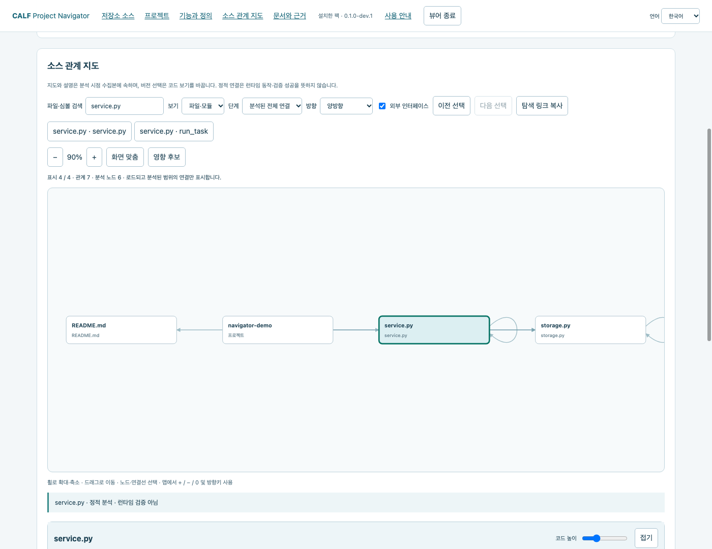
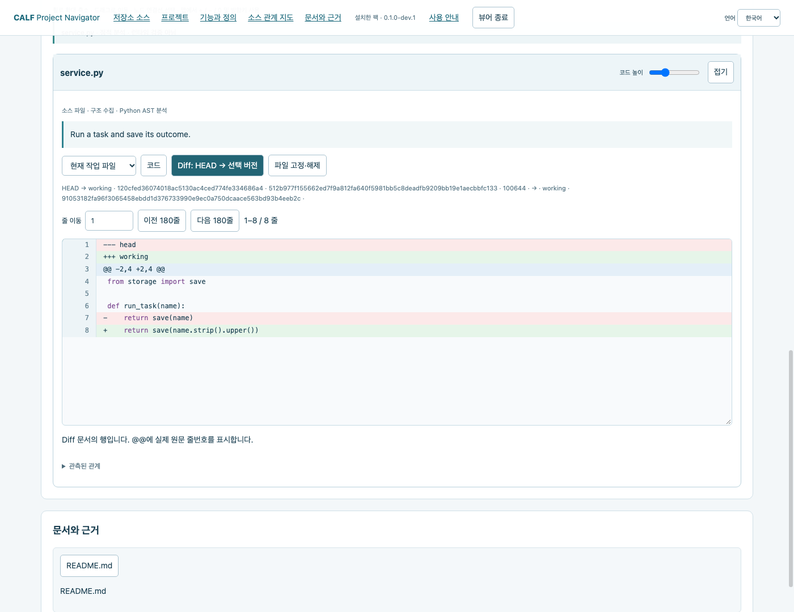
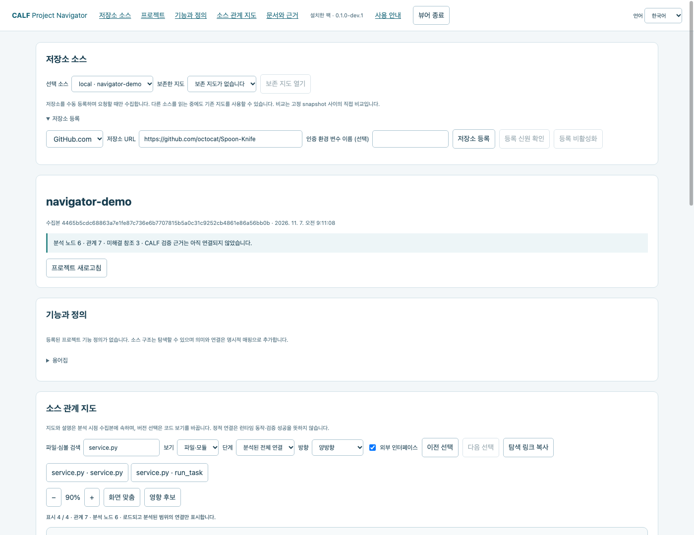
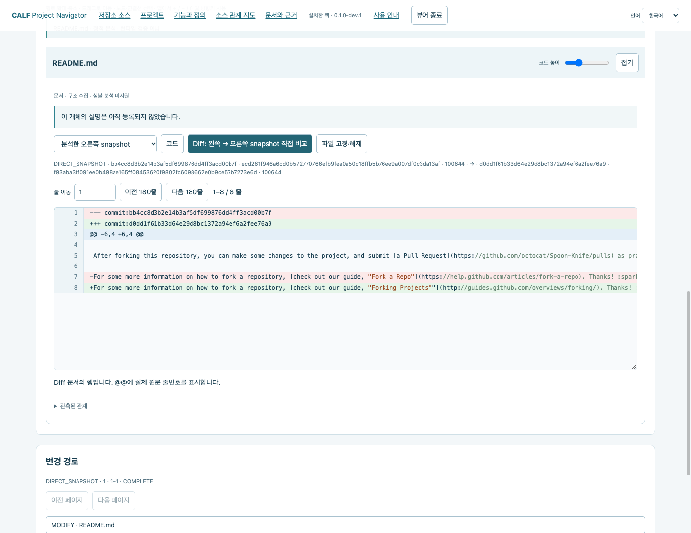
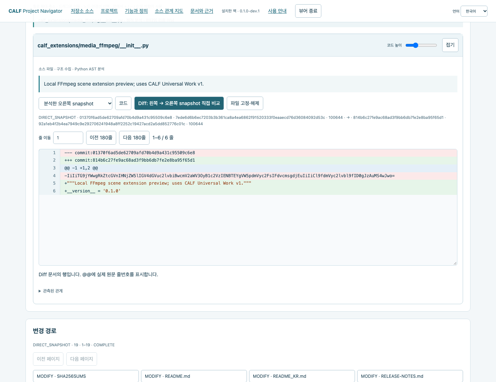
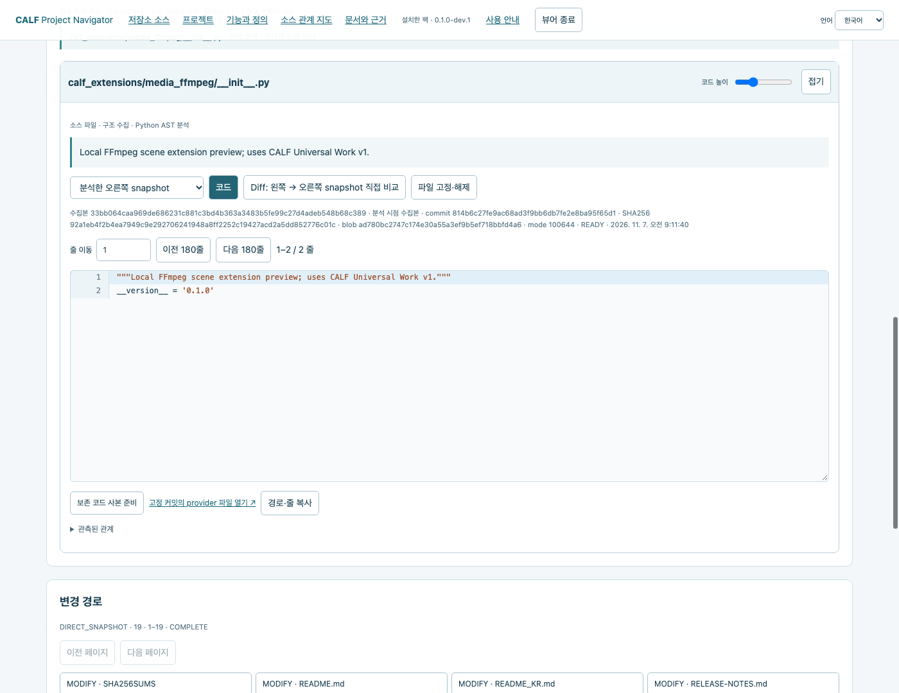

# CALF Extensions

**Repository Navigator:** [스크린샷 매뉴얼](#프로젝트-탐색-미리보기) · [한글 PDF](https://gitlab.com/vibepackr-group/CALF-Extensions/-/releases/navigator-v0.1.0-dev.1/downloads/CALF-Repository-Navigator-Guide-ko.pdf) · [English PDF](https://github.com/VibePakcr/CALF-Extensions/releases/download/navigator-v0.1.0-dev.1/CALF-Repository-Navigator-Guide-en.pdf)

## 로컬 확장팩 프리뷰

공통 팩 관리기와 Repository 팩 0.1.0-preview.1의 설치·업데이트·복구를 macOS·Windows·Linux에서 검증했습니다. [다운로드·검증 결과](https://github.com/VibePakcr/CALF-Extensions/releases/tag/packs-v0.1.0-preview.1) · [한국어 안내](docs/PACKS_GUIDE_KR.md) · [English](docs/PACKS_GUIDE.md). 읽기 전용 로컬 모드에는 Python·Git만 필요하며 모델이나 네이티브 코어는 요구하지 않습니다.


[English](README.md) · [CALF 다운로드](https://github.com/VibePakcr/CALF/blob/main/DOWNLOADS.md) · [라이선스](LICENSE-EXTENSIONS.txt)

**CALF — Controlled Agent Lifecycle Framework**에 연결하는 작은 로컬 확장 모음입니다. 비공개 코어를 수정하지 않고 런타임을 작업 계약·독립 검사·파일 버전이 연결된 실행 증거와 결합합니다.

**0.1.0 개발자 프리뷰:** [다운로드](https://github.com/VibePakcr/CALF-Extensions/releases/tag/v0.1.0) · [GitLab](https://gitlab.com/vibepackr-group/CALF-Extensions/-/releases/ffmpeg-v0.1.0) · [릴리즈 안내](RELEASE-NOTES.md). 하나의 Python 공용 패키지로 검증된 macOS·Windows·Linux 환경에서 사용합니다. CALF 앱 설치 파일과는 별도입니다.

첫 확장은 **로컬 FFmpeg 씬 작업 흐름**이며, 개발자 프리뷰로 제공합니다. **승인된 1·2번 씬은 그대로 두고 3번 씬만 수정하는 것**이 이번 구현의 핵심입니다.

## 이번 프리뷰에서 가능한 것

- 지정한 씬 하나의 새 MP4 후보를 설치된 FFmpeg로 만듭니다.
- ffprobe와 전체 디코딩으로 독립 검사합니다. 계약에서 요구하면 검은 화면과 무음 구간도 확인합니다.
- 씬·프로젝트 버전·미디어 해시·검사 영수증을 확인한 뒤 채택합니다.
- 요청한 씬의 검증된 버전만 선택합니다. 이전 승인 파일과 선택 이력은 남겨둡니다.
- 검사 후 바뀐 파일, 같은 요청 키의 다른 내용, 프로젝트 변경 이후의 오래된 채택 요청을 거절합니다.
- 이전 검증본을 다시 선택해 복원합니다. 다른 씬을 다시 렌더링하지 않습니다.

AI 호출·도구 다운로드·상주 서비스를 추가하지 않습니다. 미디어 이력 전체를 메모리에 올리지 않으며, 해시와 파일 복사에는 32 KiB 단위 스트리밍을 사용합니다. 실행 시간과 진단 출력에도 한도가 있습니다.

## 시작하기

1. [CALF Harness 또는 Workbench](https://github.com/VibePakcr/CALF/blob/main/DOWNLOADS.md)를 설치하고 별도 [CALF SDK 0.2.1](https://github.com/VibePakcr/CALF/releases/tag/sdk-v0.2.1)을 받습니다.
2. Python 3.10 이상과 FFmpeg/ffprobe를 준비합니다. FFmpeg에는 `libx264`·AAC·`blackdetect`·`silencedetect`가 필요합니다. 이 저장소에는 도구를 동봉하지 않습니다.
3. [FFmpeg 사용 안내](docs/FFMPEG_KR.md)를 따라 새 기록 폴더와 새 씬 프로젝트에서 먼저 시험합니다.

Python 표준 라이브러리와 CALF SDK만 사용합니다. SDK와 네이티브 런타임은 별도로 준비하며, 이 저장소에 복제하지 않습니다.

## AI 에이전트 연결

작업 계약은 모델에 종속되지 않습니다. Codex·Antigravity·Claude 등은 권한을 부여받은 호스트에서 CLI/SDK를 사용할 수 있습니다. CALF의 기존 stdio Work MCP로 호환 클라이언트에 실행 증거를 제공할 수도 있습니다. [에이전트·MCP 연결 안내](docs/AGENTS_KR.md)를 참고하세요.

**Claude Code 2.1.201은 실제 모델로 조회 → 1회 실행 → 재조회를 수행했습니다.** 이후 네이티브 증거를 확인하고 호스트가 승인한 씬 선택까지 검증했습니다. [Claude 연결 안내](docs/CLAUDE_KR.md)와 [실행 한도가 있는 예제](examples/claude_work.py)는 MCP 연결이 완료된 뒤에만 모델에 작업을 전달합니다. 어떤 버전을 선택할지는 AI의 완료 선언이 아니라 씬 선택 API가 결정합니다.

이 확장은 승인 파일을 덮어쓰지 않습니다. 읽기 전용 파일 속성과 해시로 변경을 보호·감지하지만 OS 샌드박스는 아닙니다. 별도 프로세스에 파일 쓰기 권한이 있으면 통제 경로 밖에서 변경할 수 있으므로, 이를 차단하려면 해당 호스트에서 권한을 제한해야 합니다.

## 실제 검증 범위

[검증 요약](VERIFICATION.json)에 도구·네이티브 코어·시험 항목을 기록했습니다. 짧은 합성 MP4로 **macOS ARM64·Windows 11 x64·Debian 13 x64에서 각각 13개 수락 항목**을 통과했습니다. 이 항목에는 계약 단위 검사 3개가 포함됩니다. Harness 1.8.7과 Workbench 1.9.2의 네이티브 코어가 같은 기록을 확인했습니다. FFmpeg는 순서대로 8.1.2·9.0.2·7.0.2를 사용했습니다.

Claude Code 실제 작업은 macOS에서 확인했습니다. Claude Desktop GUI 설정, 다른 OS·아키텍처 조합, 실제 제작 영상, 장시간 작업, 미적·의미적 검수, ComfyUI·Remotion·Veo·Runway 등 생성 API는 **이번 시험의 검증 범위가 아닙니다**. 미디어 참조 아키텍처는 후속 확장의 방향이며, 완료된 연동 목록이 아닙니다.

## 프로젝트 탐색 미리보기

[GitHub 다운로드](https://github.com/VibePakcr/CALF-Extensions/releases/tag/navigator-v0.1.0-dev.1) · [GitLab 다운로드](https://gitlab.com/vibepackr-group/CALF-Extensions/-/releases/navigator-v0.1.0-dev.1) · [한글 PDF - 9쪽](https://gitlab.com/vibepackr-group/CALF-Extensions/-/releases/navigator-v0.1.0-dev.1/downloads/CALF-Repository-Navigator-Guide-ko.pdf) · [English PDF - 9 pages](https://github.com/VibePakcr/CALF-Extensions/releases/download/navigator-v0.1.0-dev.1/CALF-Repository-Navigator-Guide-en.pdf)

### 스크린샷으로 따라가는 사용 매뉴얼

아래는 실제 설치 프리뷰 화면을 첨부한 전체 9개 장의 사용 매뉴얼입니다. 선택한 저장소와 수집 시점에 따라 소스 내용·commit·노드 수는 달라질 수 있습니다.

#### 1. 설치하고 시작하기

하나의 무료 설치 확장팩에서 Local Git·GitHub.com·GitLab.com을 같은 관계 지도와 맵 아래 설명·코드·Diff 화면으로 탐색합니다.

1. Python 3.10 이상, Git 2.43 이상과 최신 브라우저를 준비합니다. CALF core·SDK·모델은 필요하지 않습니다.
2. 신뢰할 수 있는 다운로드를 새 폴더에 풀고 공개된 SHA256과 동봉 라이선스를 확인합니다.
3. 압축을 푼 폴더에서 터미널을 열고 아래 명령을 실행합니다. Windows에서는 python3 대신 python을 사용합니다.

```sh
python3 START_NAVIGATOR.py install --home ../navigator-store --data-dir ../navigator-data --preview
python3 START_NAVIGATOR.py open --home ../navigator-store
```

설치는 네트워크 없이 예제 검사를 수행하고 Python·Git 신원을 고정합니다. 브라우저가 자동으로 열립니다. 터미널을 유지하고 마칠 때 뷰어 종료를 누르세요.

STORE·DATA·탐색할 저장소를 분리하세요. 계정 자동 검색·전역 도구 설치·상주 서비스는 추가하지 않습니다.

필요하면 설치 시 --python 절대경로 --git 절대경로를 지정하세요. open에 --no-browser를 추가하면 출력된 로컬 URL을 직접 열 수 있습니다.

#### 2. Local Git 연결과 관계 지도

1. 기존 작업 트리 하나를 명시적으로 선택합니다. 예제 경로를 실제 프로젝트 경로로 바꾸세요.
2. 파일·심볼을 검색하고 노드를 선택해 연결을 따라갑니다. 파일·모듈/파일·심볼, 들어옴/나감/양방향, 1·2·3단계/분석된 전체 연결을 선택합니다.
3. 휠로 확대·축소하고 빈 곳을 드래그해 이동합니다. + / - / 화면 맞춤과 이전·다음 선택을 사용하세요. 영향 후보는 역방향 정적 연결을 따라갑니다.

```sh
python3 START_NAVIGATOR.py open --home ../navigator-store --repo /path/to/project
```



분석된 범위에서 최대 500개 노드를 표시합니다. 정적 연결·영향 후보가 실행 동작을 증명하지는 않습니다.

Python 심볼·호출을 분석합니다. 다른 언어는 파일·문서 구조와 분석 한계를 표시합니다.

#### 3. 코드와 버전 차이 읽기

1. 노드를 선택하고 지도 아래 상세 패널에서 설명·코드·신원을 확인합니다.
2. Local Git은 분석 시점·HEAD·스테이징·작업 파일을 구분합니다. Diff는 HEAD와 선택 버전을 비교하며 충돌 stage 1·2·3도 별도로 봅니다.
3. 줄 이동·코드 높이·접기·고정을 사용할 수 있습니다. 긴 코드는 가로로 스크롤합니다. 언어 전환은 화면 문구에 적용되며 코드·주석·사용자 정의는 원문을 유지합니다.



탐색기는 소스를 커밋·체크아웃·수정하지 않습니다. Local Git 에디터 링크는 선택한 경로를 엽니다. 에디터에서 작업 파일을 편집하면 프로젝트가 바뀌므로 먼저 경로와 버전을 확인하세요.

#### 4. GitHub 저장소 등록

1. 저장소 등록을 펼치고 GitHub.com과 저장소 URL을 입력합니다. 공개 예제는 https://github.com/octocat/Spoon-Knife 입니다.
2. 공개 익명 접근은 인증 참조를 비워 둡니다. 저장소 등록 후 등록 신원 확인을 누르세요. 등록만으로 수집하지는 않습니다.
3. branch·tag·전체 commit 중 종류와 정확한 이름을 지정합니다. 예제는 branch + main입니다. 왼쪽 비교 대상을 지정하거나 첫 부모·빈 시작 상태를 유지한 뒤 수집·분석을 누르세요.



익명 API 한도가 적용됩니다. 한도·시간 초과·객체 누락은 부분 수집으로 남으며 완전한 범위를 뜻하지 않습니다. 수집 취소 시 현재 지도를 보존합니다.

#### 5. 고정된 원격 코드와 Diff 탐색

1. 수집이 끝나면 지도·검색 결과·변경 경로에서 파일을 선택합니다.
2. 원격 버전은 분석한 오른쪽·비교 왼쪽·비교 오른쪽으로 구분합니다. Diff는 고정 snapshot을 직접 비교하며 작업 트리나 merge base 비교가 아닙니다.
3. commit·blob·SHA256 신원을 확인하세요. 고정 원문 열기는 해당 commit의 파일로 연결됩니다. 원격 브랜치·파일을 수정하지 않습니다.



파일 부재·빈 파일·확보하지 못한 원문은 서로 다릅니다. 보존 바이트 누락을 빈 파일로 표시하지 않습니다.

#### 6. GitLab도 같은 흐름으로 사용

1. 저장소 등록에서 GitLab.com을 선택합니다. 공개 예제: https://gitlab.com/vibepackr-group/CALF-Extensions
2. 등록과 프로젝트 신원 확인 후 branch + main으로 수집·분석합니다. 중첩된 프로젝트 namespace를 지원합니다.
3. 지도·코드·직접 Diff·변경 경로·보존 지도는 같은 컨트롤을 사용하며 해석된 GitLab commit에 고정됩니다.



이번 프리뷰 대상은 GitHub.com·GitLab.com입니다. 자체 호스팅 서버·비공개 계정 흐름은 이 공개 예제로 검증한 범위에 포함되지 않습니다.

#### 7. 보존 지도·기능 정의·에디터 사본

1. 소스와 보존 지도를 선택해 보존 지도 열기를 누릅니다. 보존 바이트 열기는 바뀐 브랜치를 재수집하지 않습니다. 부분 결과는 명시적으로 선택해야 합니다.
2. 원격 코드는 코드 → 보존 코드 사본 준비를 선택합니다. 에디터 링크는 캐시 원본·원격 파일이 아닌 별도 사본을 가리킵니다. 실행하려면 로컬 VS Code URL 연결이 필요합니다.
3. UTF-8 --project-map 설정파일로 기능 정의·용어·코드 대상·문서 참조를 명시적으로 연결합니다. JSON 형식은 동봉 저장소 안내를 참고하세요. 누락 대상은 미해결로 유지합니다.



탐색 링크 복사는 해당 수집본의 탐색 상태를 보존합니다. 이전·다음과 파일 고정으로 연결된 코드를 비교할 수 있으며 소스 언어는 원문을 유지합니다.

#### 8. 오프라인 내보내기와 인증 참조

뷰어를 먼저 종료하고 출력 결과의 BINDING을 복사합니다. 소스를 나열해 SOURCE_ID로 명시적 ref를 수집하고 수집 결과의 CONTEXT_ID로 내보냅니다. 대문자 자리표시자를 실제 값으로 바꾸세요.

```sh
python3 START_NAVIGATOR.py run --binding BINDING -- sources list
python3 START_NAVIGATOR.py run --binding BINDING -- scan --source SOURCE_ID --ref-kind branch --ref main
python3 START_NAVIGATOR.py run --binding BINDING -- export --view CONTEXT_ID --output ../project-offline --include-source
```

--include-source를 빼면 원문 없는 구조 내보내기입니다. origin은 별도 --include-origin을 명시해야 포함합니다. 공유 전 코드·출처를 확인하고 출력 폴더의 START_HERE.html을 여세요. 오프라인 HTML에서는 등록·수집·실시간 에디터/원문 동작을 제공하지 않습니다.

기존 읽기용 인증 값을 자신의 실행 환경에 설정한 뒤 변수 이름만 전달합니다.

```sh
python3 START_NAVIGATOR.py open --home ../navigator-store --credential-env MY_READ_TOKEN
```

등록 인증 참조 칸에도 MY_READ_TOKEN이라는 이름을 입력합니다. 값은 파이프로 전달하며 실행 기록에 쓰지 않습니다. URL·명령에 인증 값을 넣지 마세요.

이 번들은 gh CLI 인증을 가져오지 않습니다. 공개 익명 접근은 인증 없이 가능하며 비공개 계정 검증은 아직 수행하지 않았습니다.

#### 9. 종료·업데이트·복구와 문제 해결

뷰어 종료는 실행 중인 로컬 서버와 해당 수집 작업을 정리합니다. 이후 탭을 닫고 원래 명령으로 다시 실행하세요. 작업 공간이 사용 중이면 기존 세션을 먼저 마칩니다. 로컬 매뉴얼을 위해 압축 해제 폴더를 유지하세요.

```sh
python3 START_NAVIGATOR.py status --home ../navigator-store
python3 START_NAVIGATOR.py install --home ../navigator-store --data-dir ../navigator-data --preview --expected-active CURRENT_DIGEST
python3 START_NAVIGATOR.py rollback --home ../navigator-store --lock OLD_LOCK --expected-active CURRENT_DIGEST --preview
```

새 신뢰 번들에서 install을 실행하되 같은 store/data와 설치 시 지정한 --repo를 유지하세요. CURRENT_DIGEST는 status, OLD_LOCK은 보존한 설치 결과에서 확인합니다.

기존 바인딩은 원래 버전을 유지하며 --home으로 새로 열면 활성 버전에 연결됩니다. 기존 팩·수집본·기록·바인딩은 이동하거나 지우지 않습니다.

| 상태 | 대응 |
| --- | --- |
| 무결성·의존 불일치 | 신뢰할 수 있는 새 압축 해제본과 정확한 의존 환경으로 다시 검증하고 기존 결과를 남깁니다. |
| 부분·원문 미확보 | 범위를 확인하세요. 한도나 객체 누락을 파일 부재로 단정하지 않습니다. |
| API 한도·인증 오류 | 제공자 초기화를 기다리거나 적합한 인증 참조를 사용합니다. |
| 심볼·기능 없음 | Python 심볼 분석과 명시적 기능 매핑은 파일 구조와 별개입니다. |
| 에디터 미실행 | 선택 경로와 로컬 URL 연결을 확인하세요. 코드 보기는 사용할 수 있습니다. |

프리뷰 한도: 파일당 1 MiB, 원문 보존 예산 64 MiB, 원격 수집당 300요청/120초입니다.

macOS·Debian·Windows에서 새 설치 CLI 흐름을 검사했습니다. 실화면·이번 브라우저 흐름은 macOS Chrome입니다. 실제 모바일·native editor·비공개 계정·자체 호스팅 검증을 수행한 것으로 주장하지 않습니다.

ZIP 안의 `manuals/ko.html` 또는 `manuals/en.html`을 열면 오프라인 웹 문서로도 읽을 수 있습니다.

[설치·복구 안내](docs/NAVIGATOR_PACK_KR.md) · [기능·용어 매핑 JSON](docs/REPOSITORY_NAVIGATOR_KR.md) · [설치본 검증·한계](docs/NAVIGATOR_PACK_VERIFICATION.json) · [H5 검증](docs/REPOSITORY_HOSTED_H5_KR.md)

## 저장소 구성

작업 소스에는 [로컬 팩 설치·업데이트 프리뷰](docs/PACK_MANAGER_KR.md)와 [공통 팩 규격](docs/EXTENSION_PACK_SPEC_KR.md)도 있습니다. 후보 팩을 준비·검수하고 의존성 잠금 정보를 보존하며 업데이트·버전 복귀 뒤에도 기존 작업을 이어갑니다. [Repository 로컬 Git inspect](docs/REPOSITORY_PACK_KR.md)는 Python·Git만 사용하는 별도 설치·검수 경로와 버전이 고정된 작업 바인딩을 지원합니다. 이 개발 기능은 **공개된 0.1.0 압축파일에는 포함되지 않았습니다.** 등록소 다운로드·필수 모델·상주 서비스를 추가하지 않으며, 모션은 이 팩 생명주기 프리뷰에서 아직 구현하지 않았으며, 별도 Repository Navigator가 관리형 foreground 뷰어를 제공합니다.

```text
calf_extensions/media_ffmpeg/   실행기·독립 검사기·씬 선택·CLI
docs/                         영문·한글 사용법과 연결 안내
examples/                     명시적 SDK 사용 예제
VERIFICATION.json             공개 검증 요약
```

비공개 CALF 엔진, 사용자 기록·계약·성향·인증정보와 생성 미디어는 포함하지 않습니다. 소스 설치로 기존 CALF 기록을 이동하거나 다시 쓰지 않습니다.

## 라이선스

[LICENSE-EXTENSIONS.txt](LICENSE-EXTENSIONS.txt)에 따라 CALF 확장 개발을 위한 소스 사용·수정·배포를 허용합니다. 기존 SDK 통합 라이선스는 [LICENSE-SDK.txt](LICENSE-SDK.txt)에 보존했습니다. 이 허용 범위에 CALF 비공개 코어는 포함되지 않습니다. FFmpeg 등 외부 구성 요소에는 각자의 라이선스가 적용됩니다.
