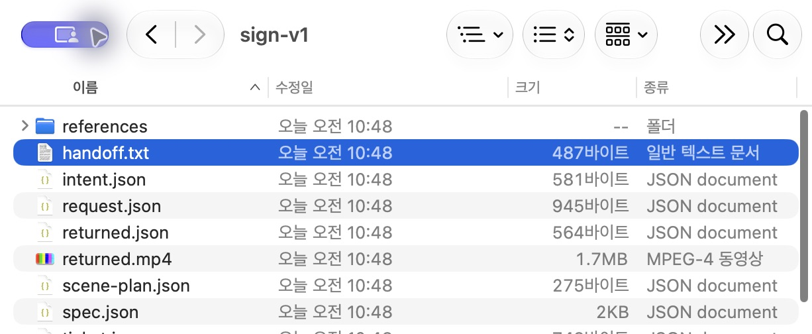
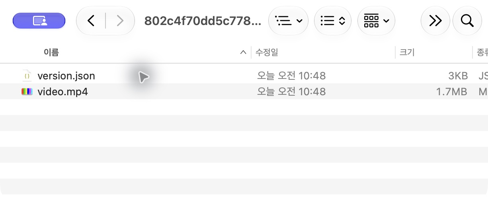
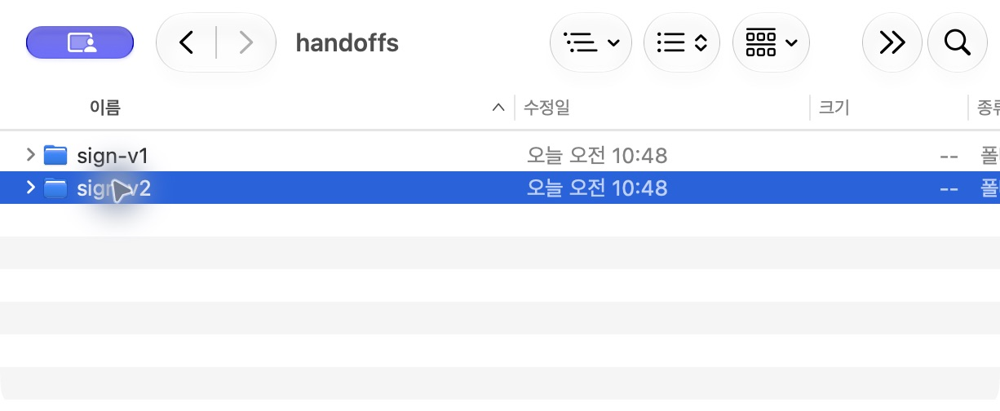
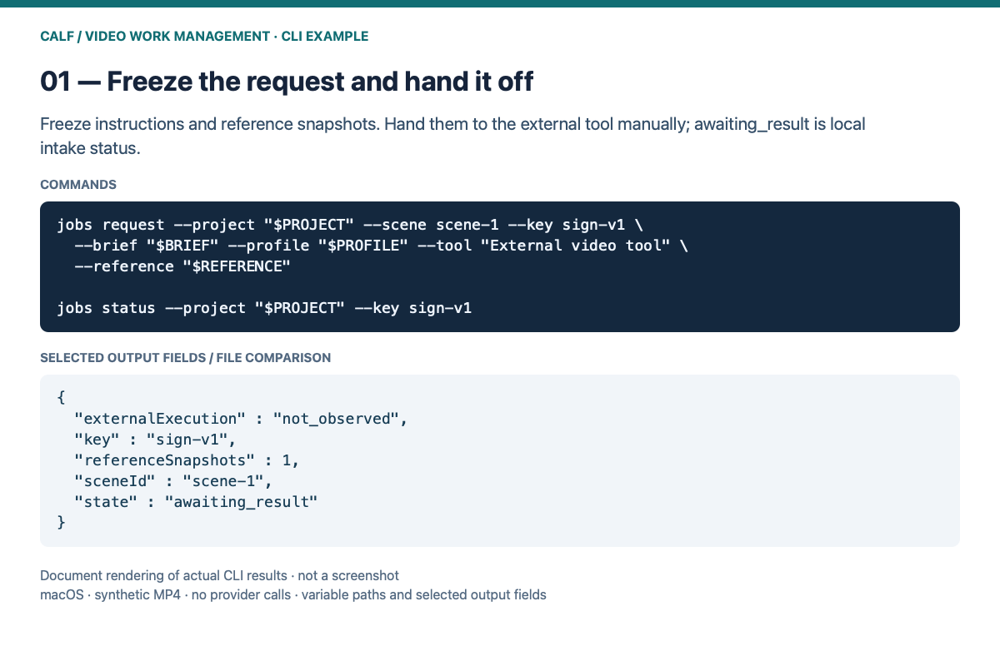
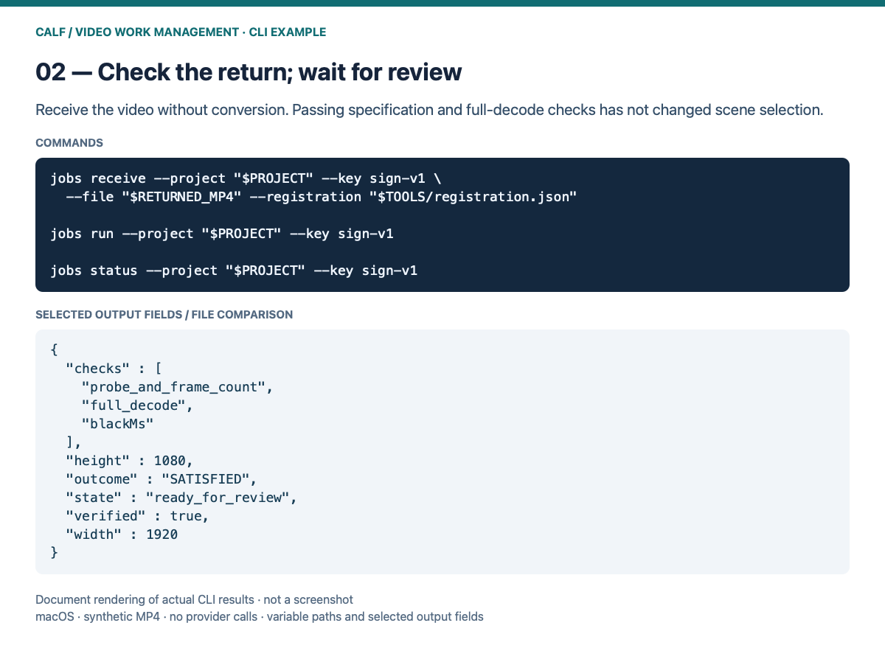
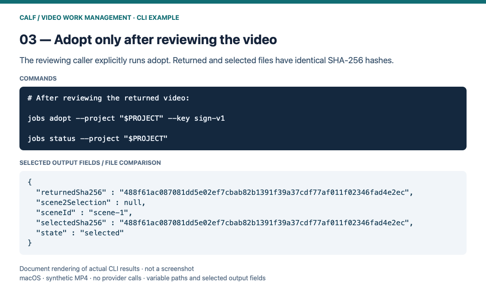
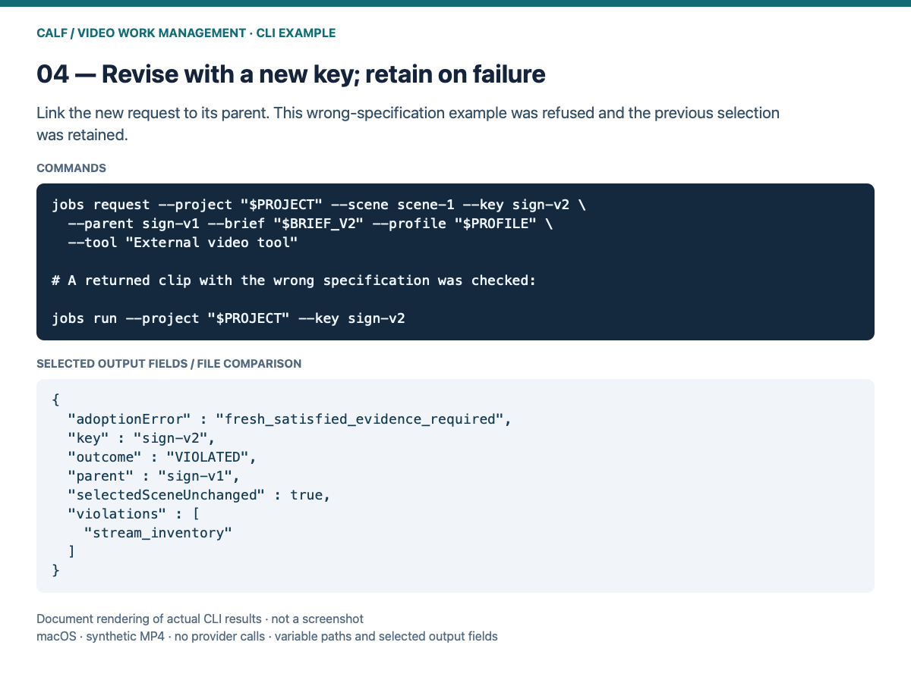

# External video-work management

[한국어](README_KR.md) · [Install with an AI assistant](../../INSTALL.md)

This source adapter connects manual external-tool handoffs and returned videos to the existing CALF scene workflow. It uses the separate SDK/native Work APIs and existing scene adoption/restoration. It does not generate, correct or interpolate video, use the motion experiments, activate an installed pack, or change host settings.

Each `PROJECT/handoffs/KEY` retains the edit instructions, tool label, scene/project base identity and reference snapshots. Hand `handoff.txt` and those snapshots to your external tool. Creating a request does not establish submission, execution or completion at that tool. There are no provider calls, uploads, credentials or generation charges.

Returned MP4s are copied byte for byte. `receive` submits one native copy/check contract; `run` advances that work once. Passing technical checks never selects a scene automatically. The caller reviews the visual/semantic result before explicitly using `adopt`.

## Illustrated walkthrough

The four screens below are **actual macOS Finder / Quick Look captures** of request, returned, selected-version and revision files from a completed synthetic MP4 demo. The OS UI is Korean; use the CLI instructions below for execution and check status. Earlier CLI-output renderings remain in the collapsed supplementary examples.

### 1. Freeze the handoff and reference snapshots

Request creation writes `PROJECT/handoffs/sign-v1/handoff.txt` and reference snapshots. Pass them to your external video tool manually. `awaiting_result` means the local workflow is waiting for a returned file.



The request folder after demo completion; files created after the request are also visible.

### 2. Receive and check the return

Point `RETURNED_MP4` at the downloaded result. Intake does not re-encode or resize it. `ready_for_review` means technical checks passed and scene selection is unchanged. Review the original/return motion and requested edit at this point.


Actual playback of the synthetic return. The operator performs visual review.

### 3. Review the video, then adopt

The reviewing caller explicitly adopts. The demo separately confirmed identical returned/selected SHA-256 hashes and an unchanged `scene-2` selection. This screen shows the retained `video.mp4` and `version.json` after adoption.



Retained files after adoption. Use the CLI for adoption/restoration; do not edit these files manually.

### 4. Request a revision; retain on failure

Write revised instructions to `BRIEF_V2`, choose a new key and link it with `--parent`. With no explicit reference, the previous return is reused. The screen retains `sign-v1` alongside `sign-v2`. The demo separately checked a wrong-specification return: its CLI verdict was `VIOLATED`, and the previous selection was retained.



A revision is a new retained request. Check its technical verdict through the CLI.

[See the user guide for setup and all step-by-step commands.](../../docs/media-jobs-manual/README.md)


<details>
<summary>Supplementary CLI results — document renderings of actual output fields</summary>









</details>

## Commands

Follow the separate SDK setup in [FFmpeg](../../docs/FFMPEG.md), then run from this repository root. Initialize new scene projects with the existing `calf_extensions.media_ffmpeg.cli init`. Variables below denote caller-selected physical absolute paths. Retain old source/SDK/tool files while existing contracts reference them.

```sh
python3 -B -m calf_extensions.media_jobs.cli --calf "$NATIVE" --home "$RECORDS" register --configuration "$TOOLS" --ffmpeg "$FFMPEG" --ffprobe "$FFPROBE"
python3 -B -m calf_extensions.media_jobs.cli request --project "$PROJECT" --scene scene-1 --key sign-v1 --brief "$BRIEF" --profile "$PROFILE" --tool 'Gemini/Veo manual handoff' --reference "$REFERENCE"
```

`--brief` is a UTF-8 instruction file. `--profile` is JSON, for example:

```json
{"width":1920,"height":1080,"fps":25,"startMs":0,"durationMs":1000,"audio":false,"maxBlackMs":100,"maxSilenceMs":null}
```

Repeat `--reference` up to eight times. Omit it to snapshot the currently selected scene. The same key/intent retrieves the same request; changed intent or another candidate needs a new key. After manually downloading a result:

```sh
python3 -B -m calf_extensions.media_jobs.cli --calf "$NATIVE" --home "$RECORDS" receive --project "$PROJECT" --key sign-v1 --file "$RETURNED_MP4" --registration "$TOOLS/registration.json"
python3 -B -m calf_extensions.media_jobs.cli --calf "$NATIVE" --home "$RECORDS" run --project "$PROJECT" --key sign-v1
python3 -B -m calf_extensions.media_jobs.cli --calf "$NATIVE" --home "$RECORDS" status --project "$PROJECT"
# Only after caller review and authorization:
python3 -B -m calf_extensions.media_jobs.cli --calf "$NATIVE" --home "$RECORDS" adopt --project "$PROJECT" --key sign-v1
```

For a revision, issue `request` with a new key and `--parent sign-v1`. Without explicit references it snapshots that parent's returned video; the new base is the current project at request creation. Earlier records remain unchanged. Use the original FFmpeg CLI `restore` to select a retained validated scene.

## Status, recovery and agents

Status includes the request/references/return hash and actual native view. States include `awaiting_result`, `ready_to_check`, `ready_for_review`, `selected`, `retained_version`, `needs_attention` and `unresolved`. External execution is always `not_observed`. Without `--calf/--home`, a submitted work's native status is `native_status_unavailable`.

After a lost submit response, use `reconcile --project "$PROJECT" --key sign-v1` with `--calf/--home`. Public native list/inspect calls recover the same work; nothing is resubmitted. Unconfirmed submissions, partial snapshots and stale locks stay unresolved and are not overwritten/cleared automatically. Late results are retained, but the existing selector rejects adoption against a changed project.

Agents can call the JSON CLI or Python manager functions. A returned native work ID can be inspected/checked using the existing Work MCP. Use this CLI/Python `adopt` for scene selection: native Work adoption alone does not update the scene manifest. No separate scene MCP server or approval layer is added. Manual file interchange does not qualify any provider API or agent client.

## Bounds and verification

Intake is bounded to 64 MiB, 30 seconds, dimensions up to 3840×2160, integer 24/25/30 fps, H.264/yuv420p MP4, with either no audio or AAC 48 kHz stereo. `startMs` must be zero: no trimming/conversion. Existing ffprobe metadata checks and full decoding verify the frozen specification; configured black/silence limits still apply. Mismatch/timeouts never trigger conversion or a false pass. The original encoding pack retains its unchanged 720p bounds.

Run isolated synthetic acceptance with a new directory:

```sh
python3 -B -m calf_extensions.media_jobs.verify --calf "$NATIVE" --ffmpeg "$FFMPEG" --ffprobe "$FFPROBE" --output "$NEW_TEST_DIRECTORY"
```

It exercises handoff, repeated return, revision lineage, existing adoption/restoration, rejection, lost-response recovery and identical 1080p file hashes. Local macOS qualification only. Windows/Linux, 4K runtime, production footage, provider APIs and real external agent clients are not qualified by this test. Technical checks do not establish aesthetic/semantic quality or an OS sandbox against unrelated filesystem writers.
