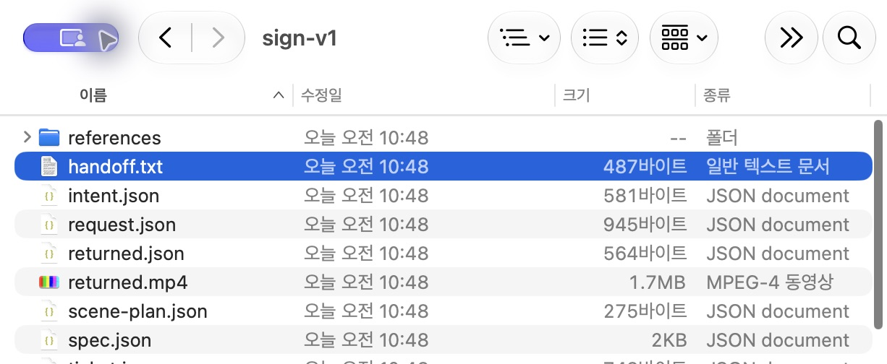
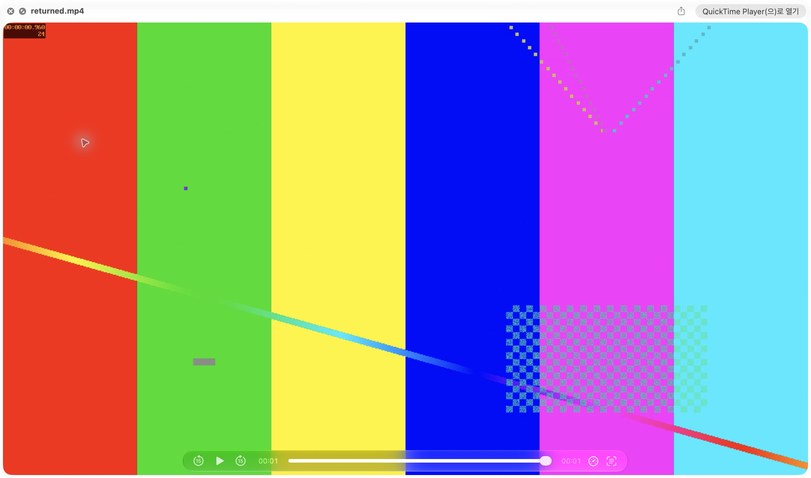
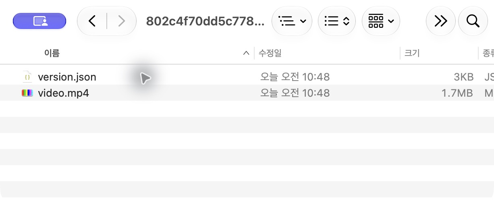
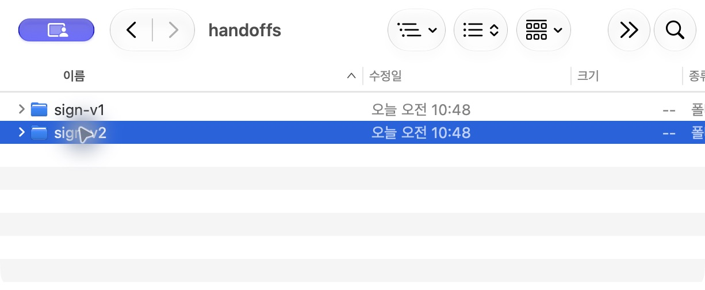
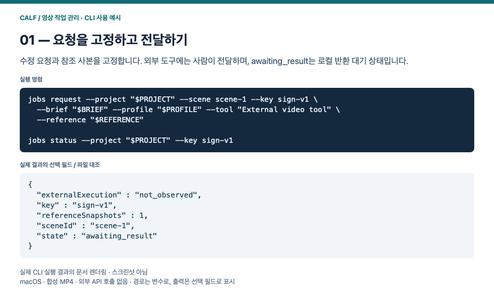
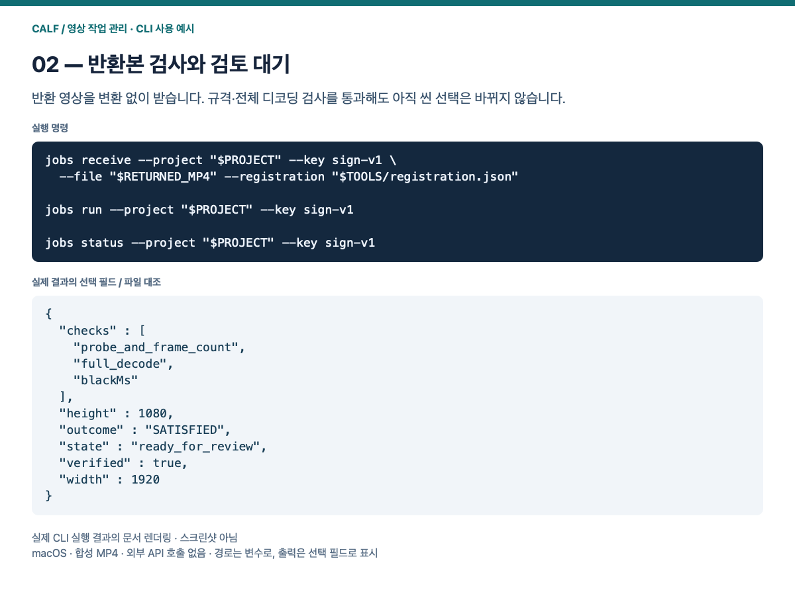
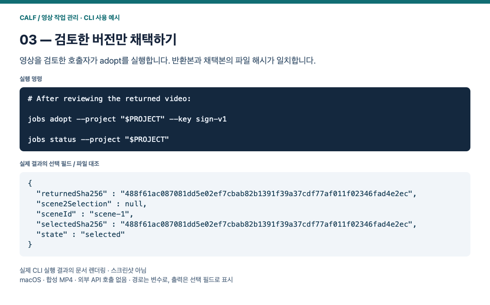
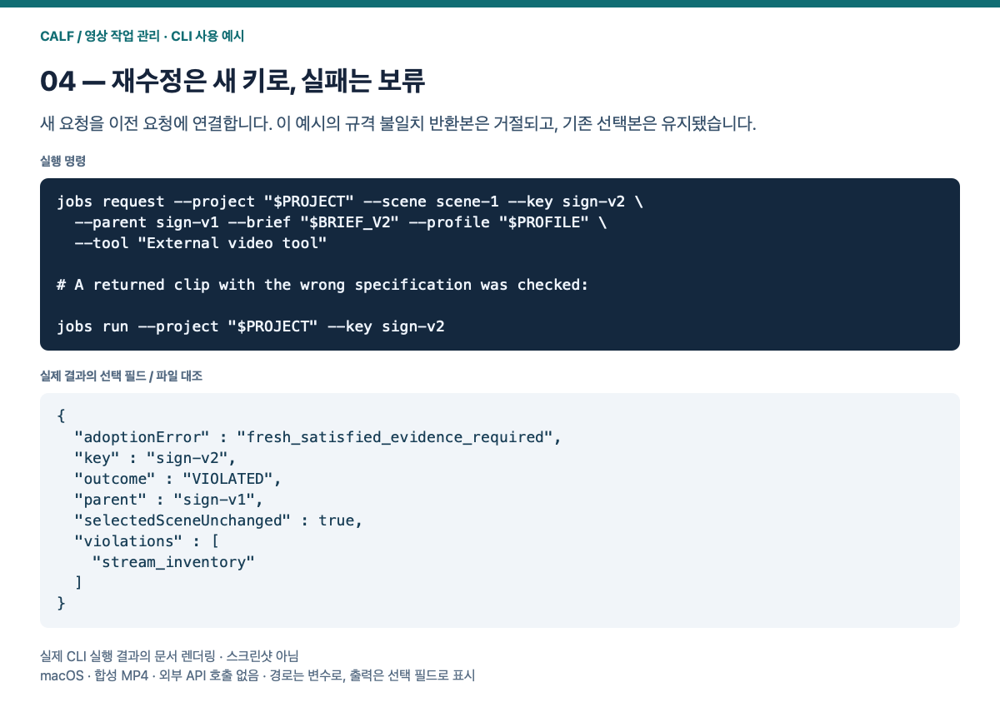

# 외부 영상 작업 관리

[English](README.md) · [AI와 함께 설치하기](../../INSTALL_KR.md)

영상 생성·보정기가 아니라, 외부 도구에 전달할 수정 요청과 반환 결과를 기존 CALF 씬 작업에 연결하는 소스 어댑터입니다. 기존 SDK·네이티브 Work API와 씬 검사·채택·복원을 재사용합니다. 설치된 팩이나 호스트 설정을 자동으로 바꾸지 않습니다. 모션 보정 실험 모듈은 사용하지 않습니다.

각 요청은 수정 내용, 도구 이름, 대상 씬, 현재 프로젝트/씬 버전과 참조 파일 사본을 `PROJECT/handoffs/KEY`에 보관합니다. `handoff.txt`와 참조 사본을 Gemini/Veo 등 사용 중인 도구에 사람이 전달합니다. 요청서를 만들었다고 외부 제출·실행·완료를 주장하지 않습니다. API·업로드·계정·과금 기능은 없습니다.

반환 파일은 재인코딩·크기 변경·프레임 보간 없이 보관합니다. `receive`는 네이티브 CALF에 복사/검사 계약을 한 번 제출하고, `run`은 기존 실행기를 한 번 진행합니다. 검사를 통과해도 `adopt`를 명시적으로 호출하기 전에는 씬 선택을 바꾸지 않습니다. 미적 품질·수정 요청 충족 여부는 사람이 검토합니다.

## 그림으로 따라가기

아래 네 화면은 **실제 macOS Finder·빠른 보기 캡처**입니다. 완료된 합성 MP4 데모의 요청·반환·채택·재수정 파일을 보여 줍니다. OS 화면은 한국어이며, 작업 실행과 검사 상태는 아래 CLI 설명을 따릅니다. 기존 CLI 결과 렌더링은 접힌 보조 예시에 보존했습니다.

### 1. 요청서와 참조 사본 만들기

요청을 만들면 `PROJECT/handoffs/sign-v1/handoff.txt`와 참조 사본이 생깁니다. 이를 사용 중인 외부 영상 도구에 사람이 전달합니다. `awaiting_result`는 로컬에서 반환을 기다린다는 뜻입니다.



데모 완료 후의 요청 폴더입니다. 요청 이후 생성된 반환 파일도 함께 보입니다.

### 2. 반환본을 받아 검사하기

외부 도구에서 받은 파일을 `RETURNED_MP4`로 지정합니다. 파일을 재인코딩하거나 축소하지 않습니다. 기술 검사 통과 후 `ready_for_review`가 되어도 선택본은 그대로이며, 이 시점에 원본·반환본의 움직임과 수정 내용을 직접 검토합니다.



합성 반환본의 실제 재생 화면입니다. 시각 검토는 작업자가 수행합니다.

### 3. 영상을 검토한 뒤 채택하기

검토 결과를 채택하기로 한 호출자가 실행합니다. 데모에서는 반환 파일과 채택 파일의 SHA-256 일치와 `scene-2` 선택 보존을 별도로 확인했습니다. 화면은 채택 후 보관된 `video.mp4`와 `version.json`입니다.



채택 후 보존된 파일입니다. 파일을 직접 수정하지 말고 CLI로 채택·복원합니다.

### 4. 재수정 요청과 실패한 후보 다루기

`BRIEF_V2`에 새 수정 내용을 작성하고 새 키와 `--parent`로 요청을 만듭니다. 참조를 생략하면 이전 반환본을 재사용합니다. 화면처럼 `sign-v1`을 남기고 `sign-v2`를 추가합니다. 데모의 규격 불일치 반환본은 별도 CLI 검사에서 `VIOLATED`로 기록됐고 기존 선택본이 유지됐습니다.



재수정은 새 요청으로 남습니다. 검사 통과 여부는 CLI에서 확인합니다.

[새 프로젝트 준비와 전체 단계별 명령은 사용 매뉴얼에서 확인하세요.](../../docs/media-jobs-manual/README_KR.md)


<details>
<summary>CLI 실행 결과 보조 예시 — 실제 출력 필드의 문서 렌더링</summary>









</details>

## 사용

기존 [FFmpeg 안내](../../docs/FFMPEG_KR.md)에 따라 별도 CALF SDK를 현재 프로세스에서 import할 수 있게 준비하고, 이 저장소 루트에서 실행합니다. 새 프로젝트가 필요하면 기존 `calf_extensions.media_ffmpeg.cli init`을 사용합니다. `NATIVE`, `RECORDS`, `PROJECT`, `TOOLS` 등은 사용자가 정한 물리 절대 경로입니다. 기존 계약에 참조된 소스·도구·SDK 파일은 교체하지 않습니다.

```sh
python3 -B -m calf_extensions.media_jobs.cli --calf "$NATIVE" --home "$RECORDS" register --configuration "$TOOLS" --ffmpeg "$FFMPEG" --ffprobe "$FFPROBE"
python3 -B -m calf_extensions.media_jobs.cli request --project "$PROJECT" --scene scene-1 --key sign-v1 --brief "$BRIEF" --profile "$PROFILE" --tool 'Gemini/Veo 수동 전달' --reference "$REFERENCE"
```

`--brief`는 UTF-8 수정 요청 파일, `--profile`은 아래 형식의 JSON입니다. `--reference`는 최대 8번 지정할 수 있습니다. 생략하면 현재 선택된 해당 씬을 참조로 복사합니다. 같은 키·같은 입력을 다시 쓰면 기존 요청서를 돌려줍니다. 다른 의도·후보는 새 키를 사용합니다.

```json
{"width":1920,"height":1080,"fps":25,"startMs":0,"durationMs":1000,"audio":false,"maxBlackMs":100,"maxSilenceMs":null}
```

외부 작업 후 내려받은 MP4를 지정합니다.

```sh
python3 -B -m calf_extensions.media_jobs.cli --calf "$NATIVE" --home "$RECORDS" receive --project "$PROJECT" --key sign-v1 --file "$RETURNED_MP4" --registration "$TOOLS/registration.json"
python3 -B -m calf_extensions.media_jobs.cli --calf "$NATIVE" --home "$RECORDS" run --project "$PROJECT" --key sign-v1
python3 -B -m calf_extensions.media_jobs.cli --calf "$NATIVE" --home "$RECORDS" status --project "$PROJECT"
```

원본·반환본을 검토하고 채택하기로 한 호출자만 다음 명령을 실행합니다.

```sh
python3 -B -m calf_extensions.media_jobs.cli --calf "$NATIVE" --home "$RECORDS" adopt --project "$PROJECT" --key sign-v1
```

재수정은 새 키와 `--parent sign-v1`을 지정해 `request`를 만듭니다. 참조를 지정하지 않으면 이전 요청의 반환본을 가져오며, 새 요청의 기준 버전은 그 시점의 현재 프로젝트입니다. 이전 기록은 고치지 않습니다. 이전 씬으로의 복원은 기존 FFmpeg CLI `restore`를 그대로 사용합니다.

## 조회와 복구

`status`는 요청·참조·반환 해시와 실제 네이티브 상태를 함께 보여 줍니다. 주요 상태는 `awaiting_result`, `ready_to_check`, `ready_for_review`, `selected`, `retained_version`, `needs_attention`, `unresolved`입니다. `externalExecution: not_observed`는 외부 실행을 관측하지 않았다는 뜻입니다. `--calf/--home` 없이 조회하면 네이티브 상태는 `native_status_unavailable`로 표시합니다.

제출 응답이 유실되면 같은 키를 재제출하지 않습니다. `reconcile --project "$PROJECT" --key sign-v1`을 `--calf/--home`과 함께 실행하여 공개 list/inspect API로 기존 작업을 찾습니다. 확인되지 않으면 미해결로 남깁니다. 부분 파일·잠금은 자동으로 지우거나 덮어쓰지 않습니다. 결과가 늦게 도착했어도 보관할 수 있지만, 프로젝트가 바뀌었다면 기존 선택기가 채택을 거부합니다.

범용 에이전트는 위 JSON CLI나 Python manager 함수를 호출할 수 있습니다. 네이티브 작업 ID로 기존 Work MCP의 조회·검사를 사용할 수 있으며, 씬 선택은 이 CLI/Python `adopt`를 거쳐야 합니다. 별도 씬 MCP 서버나 새 승인 계층을 만들지 않았습니다. 외부 도구 지원은 수동 파일 교환 범위이며 실제 Gemini/Veo API 연동을 검증한 것은 아닙니다.

## 지원 범위와 검증

현재 인입 계약은 64 MiB 이하, 최대 30초, 최대 3840×2160, 24/25/30 정수 fps, H.264/yuv420p MP4입니다. 오디오는 없거나 AAC 48 kHz 2채널입니다. `startMs`는 0이며 자르기·변환을 하지 않습니다. 해상도·길이·프레임 수·코덱·스트림은 독립 ffprobe 검사와 전체 디코딩으로 확인하고, 명시한 검은 화면·무음 기준을 적용합니다. 불일치·시간 초과는 자동 변환이나 통과로 바꾸지 않습니다. 기존 인코더 팩의 720p 제한은 그대로 보존합니다.

로컬 합성 영상의 수동 전달·동일 반환·재수정·기존 씬 채택/복원·거부·응답 유실 복구·1080p 파일 해시 보존을 검증하는 명령입니다. 새 출력 폴더와 별도 네이티브 기록을 사용합니다.

```sh
python3 -B -m calf_extensions.media_jobs.verify --calf "$NATIVE" --ffmpeg "$FFMPEG" --ffprobe "$FFPROBE" --output "$NEW_TEST_DIRECTORY"
```

macOS 로컬 검증 범위입니다. Windows/Linux 실행, 4K 처리 시간, 실제 납품 영상, Gemini/Veo·다른 에이전트 클라이언트의 실제 호출은 이 검증에 포함되지 않습니다.
