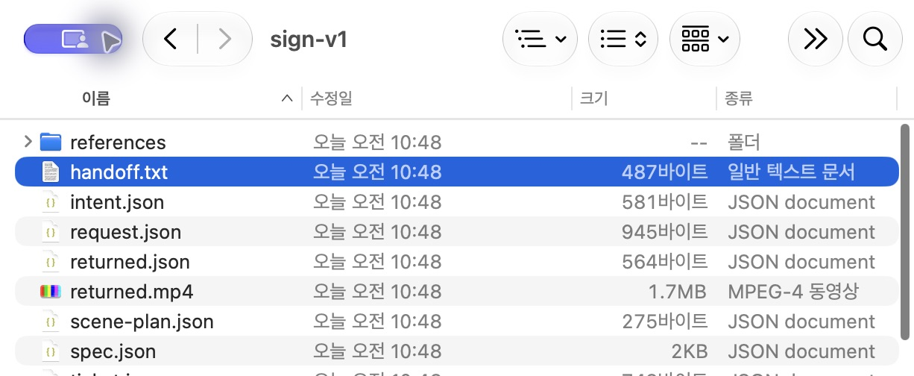
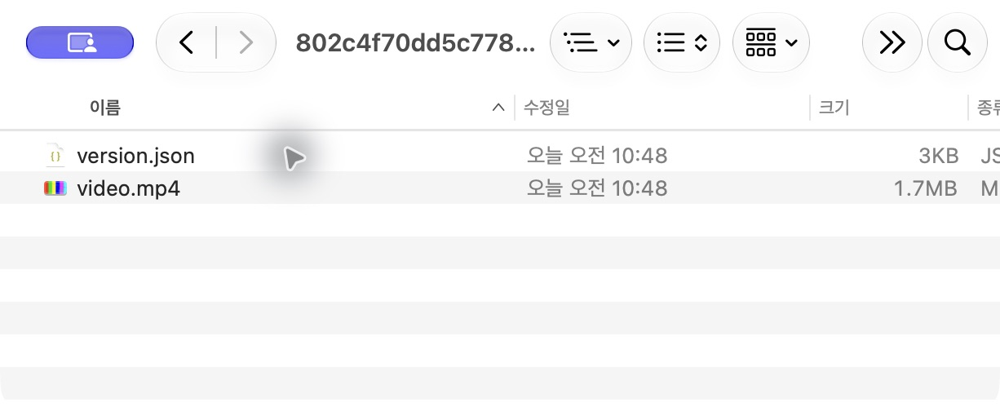
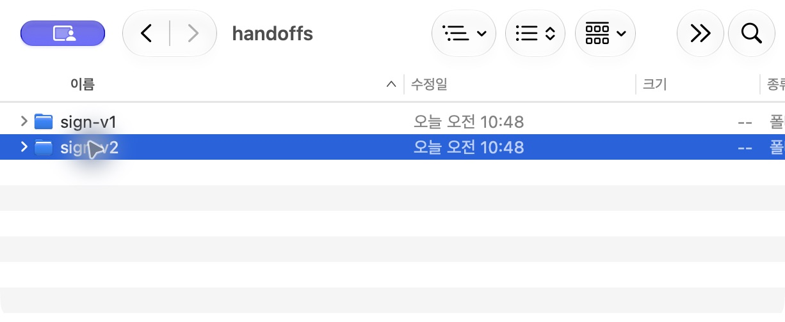
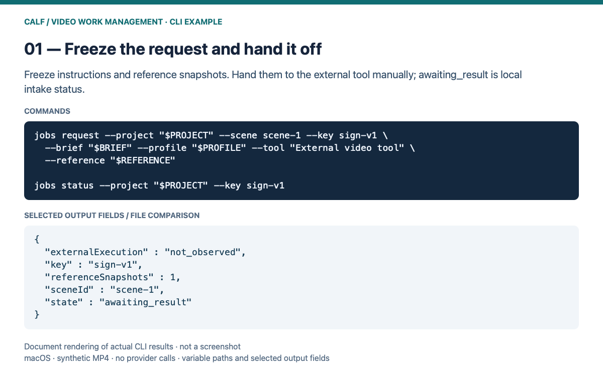
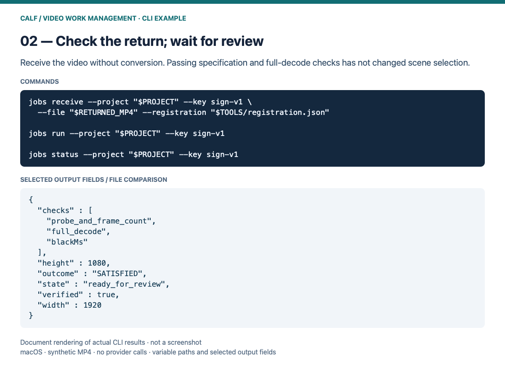
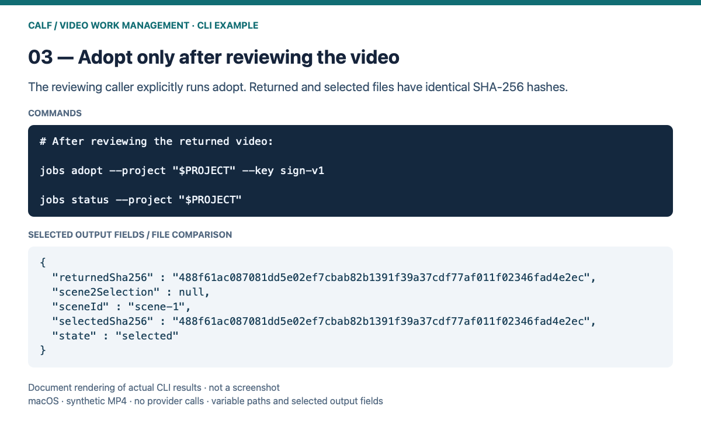
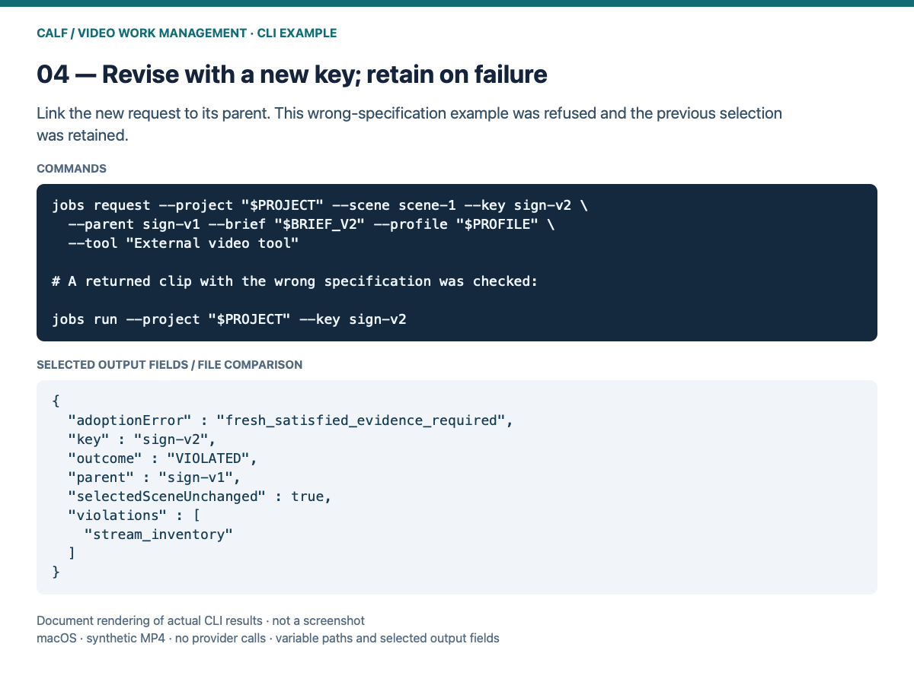

# Video work management guide

[한국어](README_KR.md) · [Install first](../../INSTALL.md) · [Overview](../../README.md)

<a id="media-jobs-manual"></a>

## External video-work management — illustrated walkthrough

**Video Work Management Pack 0.1.0-preview.1:** connect handoffs, returns, adoption and revisions to existing CALF. [GitHub](https://github.com/VibePakcr/CALF-Extensions/releases/tag/media-jobs-v0.1.0-preview.1) · [GitLab](https://gitlab.com/vibepackr-group/CALF-Extensions/-/releases/media-jobs-v0.1.0-preview.1)

The four screens below are **actual macOS Finder / Quick Look captures** of request, returned, selected-version and revision files from a completed synthetic MP4 demo. The OS UI is Korean; use the CLI instructions below for execution and check status. Earlier CLI-output renderings remain in the collapsed supplementary examples.

### Before you start

Prepare Python 3.10+, the separate CALF SDK/native executable and FFmpeg/ffprobe. Choose new records, project and tool-configuration paths. Commands use macOS/Linux shell syntax; this addition was actually exercised on macOS. Windows PowerShell commands are not qualified here.

```sh
# Run from the extracted source root; choose physical absolute paths.
export SDK="/absolute/path/to/CALF-SDK-0.2.1"
export NATIVE="/absolute/path/to/calf"
export RECORDS="/absolute/path/to/new-records"
export PROJECT="/absolute/path/to/new-scenes"
export TOOLS="/absolute/path/to/new-tools"
export FFMPEG="/absolute/path/to/ffmpeg"
export FFPROBE="/absolute/path/to/ffprobe"
export BRIEF="/absolute/path/to/edit.txt"
export BRIEF_V2="/absolute/path/to/revision.txt"
export PROFILE="/absolute/path/to/delivery.json"
export REFERENCE="/absolute/path/to/reference.mp4"
export RETURNED_MP4="/absolute/path/to/downloaded-result.mp4"
export PYTHONPATH="$PWD:$SDK"
jobs() { python3 -B -m calf_extensions.media_jobs.cli --calf "$NATIVE" --home "$RECORDS" "$@"; }
python3 -B -m calf_extensions.media_ffmpeg.cli init --project "$PROJECT" --scenes scene-1 scene-2
jobs register --configuration "$TOOLS" --ffmpeg "$FFMPEG" --ffprobe "$FFPROBE"
```

Write UTF-8 edit instructions to `BRIEF` and delivery JSON to `PROFILE`, for example below. The demo is one second, 1080p, 25 fps with no audio. Use the intended delivery specification for your work; failure never lowers it automatically.

```json
{"width":1920,"height":1080,"fps":25,"startMs":0,"durationMs":1000,"audio":false,"maxBlackMs":100,"maxSilenceMs":null}
```

### 1. Freeze the handoff and reference snapshots

Request creation writes `PROJECT/handoffs/sign-v1/handoff.txt` and reference snapshots. Pass them to your external video tool manually. `awaiting_result` means the local workflow is waiting for a returned file.

```sh
jobs request --project "$PROJECT" --scene scene-1 --key sign-v1 \
  --brief "$BRIEF" --profile "$PROFILE" --tool 'External video tool' \
  --reference "$REFERENCE"
jobs status --project "$PROJECT" --key sign-v1
```



The request folder after demo completion; files created after the request are also visible.

### 2. Receive and check the return

Point `RETURNED_MP4` at the downloaded result. Intake does not re-encode or resize it. `ready_for_review` means technical checks passed and scene selection is unchanged. Compare the original and returned video, including motion and the requested edit.

```sh
jobs receive --project "$PROJECT" --key sign-v1 --file "$RETURNED_MP4" \
  --registration "$TOOLS/registration.json"
jobs run --project "$PROJECT" --key sign-v1
jobs status --project "$PROJECT" --key sign-v1
```


Actual playback of the synthetic return. The operator performs visual review.

### 3. Review the video, then adopt

After reviewing the result, the caller explicitly selects it with adopt. The demo separately confirmed identical returned/selected SHA-256 hashes and an unchanged `scene-2` selection. This screen shows the retained `video.mp4` and `version.json` after adoption.

```sh
jobs adopt --project "$PROJECT" --key sign-v1
jobs status --project "$PROJECT"
```



Retained files after adoption. Use the CLI for adoption/restoration; do not edit these files manually.

### 4. Request a revision; retain on failure

Write revised instructions to `BRIEF_V2`, choose a new key and link it with `--parent`. With no explicit reference, the previous return is reused. The screen retains `sign-v1` alongside `sign-v2`. The demo separately checked a wrong-specification return: its CLI verdict was `VIOLATED`, and the previous selection was retained.

```sh
jobs request --project "$PROJECT" --scene scene-1 --key sign-v2 --parent sign-v1 \
  --brief "$BRIEF_V2" --profile "$PROFILE" --tool 'External video tool'
```



Each revision creates a new request and preserves the earlier one. Check its technical verdict through the CLI.

After a lost submit response, do not resubmit. Use `jobs reconcile --project "$PROJECT" --key sign-v1` to find the existing work. Restore a retained version through the original FFmpeg CLI `restore`. Technical checks do not establish aesthetic quality or satisfaction of the requested edit.

[Full commands, input bounds and recovery](../../calf_extensions/media_jobs/README.md)


<details>
<summary>Supplementary CLI results — document renderings of actual output fields</summary>









</details>
