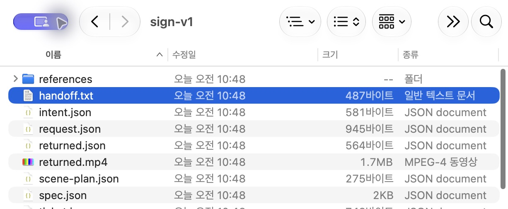
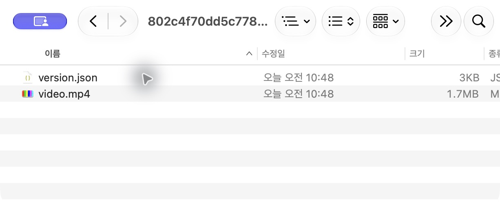
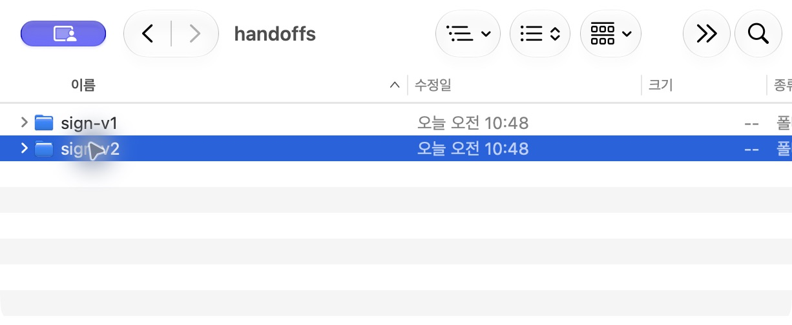
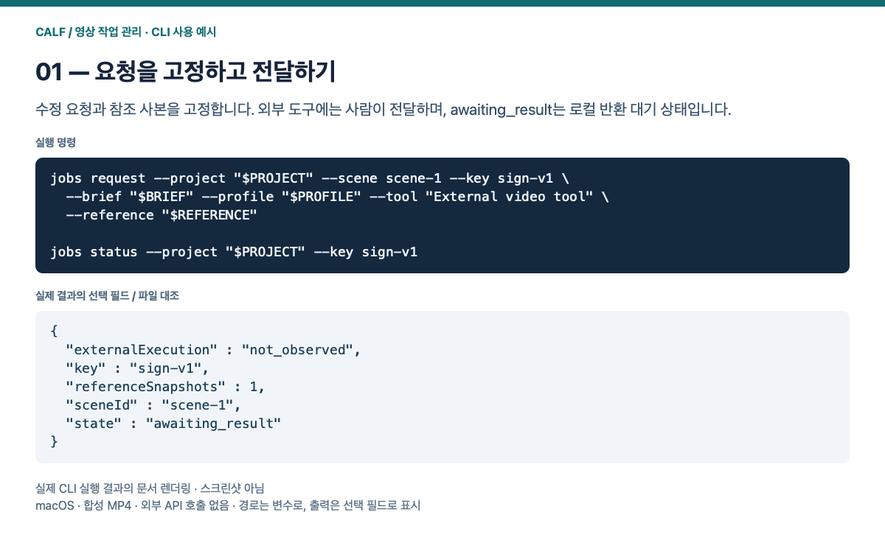
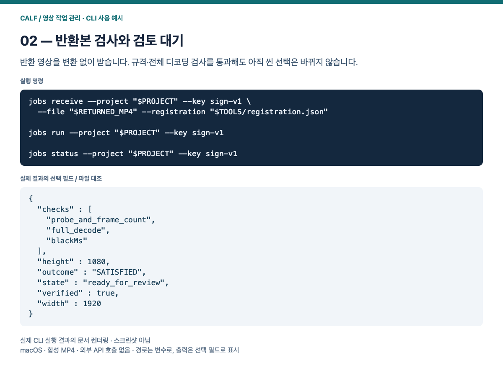
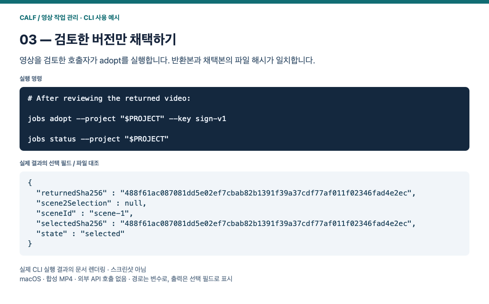
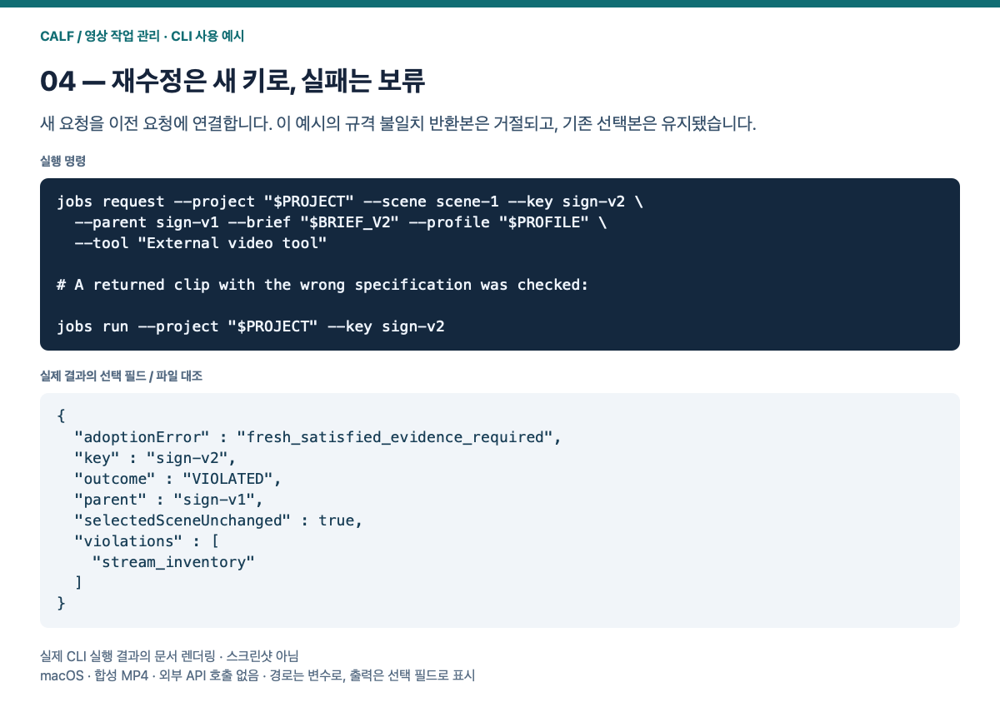

# 영상 작업 관리 사용 매뉴얼

[English](README.md) · [처음 설치하기](../../INSTALL_KR.md) · [전체 안내](../../README_KR.md)

<a id="media-jobs-manual"></a>

## 외부 영상 작업 관리 — 단계별 사용 매뉴얼

**영상 작업 관리 팩 0.1.0-preview.1:** 요청·반환·채택·재수정 기록을 기존 CALF 씬 흐름에 연결합니다. [GitHub](https://github.com/VibePakcr/CALF-Extensions/releases/tag/media-jobs-v0.1.0-preview.1) · [GitLab](https://gitlab.com/vibepackr-group/CALF-Extensions/-/releases/media-jobs-v0.1.0-preview.1)

아래 네 화면은 **실제 macOS Finder·빠른 보기 캡처**입니다. 완료된 합성 MP4 데모의 요청·반환·채택·재수정 파일을 보여 줍니다. OS 화면은 한국어이며, 작업 실행과 검사 상태는 아래 CLI 설명을 따릅니다. 기존 CLI 결과 렌더링은 접힌 보조 예시에 보존했습니다.

### 시작 전 준비

먼저 Python 3.10 이상, 별도 CALF SDK·네이티브 실행기, FFmpeg/ffprobe를 준비합니다. 새로운 기록·프로젝트·도구 설정 경로를 정하세요. 아래 명령은 macOS/Linux 셸 표기이며 이번 실제 실행은 macOS에서 확인했습니다. Windows PowerShell 명령은 이 추가분에서 검증하지 않았습니다.

```sh
# Run from the extracted source root; choose physical absolute paths.
export SDK="/absolute/path/to/CALF-SDK-0.2.1"
export NATIVE="/absolute/path/to/calf"
export RECORDS="/absolute/path/to/new-records"
export PROJECT="/absolute/path/to/new-scenes"
export TOOLS="/absolute/path/to/new-tools"
export FFMPEG="/absolute/path/to/ffmpeg"
export FFPROBE="/absolute/path/to/ffprobe"
export BRIEF="/absolute/path/to/edit.txt"
export BRIEF_V2="/absolute/path/to/revision.txt"
export PROFILE="/absolute/path/to/delivery.json"
export REFERENCE="/absolute/path/to/reference.mp4"
export RETURNED_MP4="/absolute/path/to/downloaded-result.mp4"
export PYTHONPATH="$PWD:$SDK"
jobs() { python3 -B -m calf_extensions.media_jobs.cli --calf "$NATIVE" --home "$RECORDS" "$@"; }
python3 -B -m calf_extensions.media_ffmpeg.cli init --project "$PROJECT" --scenes scene-1 scene-2
jobs register --configuration "$TOOLS" --ffmpeg "$FFMPEG" --ffprobe "$FFPROBE"
```

`BRIEF`에는 UTF-8 수정 요청을, `PROFILE`에는 다음과 같은 JSON을 작성합니다. 데모는 1초·1080p·25fps·무음 MP4입니다. 실제 작업에서는 의도한 납품 규격을 지정하며, 실패 후 기준을 자동으로 낮추지 않습니다.

```json
{"width":1920,"height":1080,"fps":25,"startMs":0,"durationMs":1000,"audio":false,"maxBlackMs":100,"maxSilenceMs":null}
```

### 1. 요청서와 참조 사본 만들기

요청을 만들면 `PROJECT/handoffs/sign-v1/handoff.txt`와 참조 사본이 생깁니다. 이를 사용 중인 외부 영상 도구에 사람이 전달합니다. `awaiting_result`는 로컬에서 반환을 기다린다는 뜻입니다.

```sh
jobs request --project "$PROJECT" --scene scene-1 --key sign-v1 \
  --brief "$BRIEF" --profile "$PROFILE" --tool 'External video tool' \
  --reference "$REFERENCE"
jobs status --project "$PROJECT" --key sign-v1
```



데모 완료 후의 요청 폴더입니다. 요청 이후 생성된 반환 파일도 함께 보입니다.

### 2. 반환본을 받아 검사하기

외부 도구에서 받은 파일을 `RETURNED_MP4`로 지정합니다. 파일을 재인코딩하거나 축소하지 않습니다. 기술 검사 통과 후 `ready_for_review`가 되어도 선택본은 그대로이며, 이 시점에 원본·반환본의 움직임과 수정 내용을 직접 검토합니다.

```sh
jobs receive --project "$PROJECT" --key sign-v1 --file "$RETURNED_MP4" \
  --registration "$TOOLS/registration.json"
jobs run --project "$PROJECT" --key sign-v1
jobs status --project "$PROJECT" --key sign-v1
```


합성 반환본의 실제 재생 화면입니다. 시각 검토는 작업자가 수행합니다.

### 3. 영상을 검토한 뒤 채택하기

검토 결과를 채택하기로 한 호출자가 실행합니다. 데모에서는 반환 파일과 채택 파일의 SHA-256 일치와 `scene-2` 선택 보존을 별도로 확인했습니다. 화면은 채택 후 보관된 `video.mp4`와 `version.json`입니다.

```sh
jobs adopt --project "$PROJECT" --key sign-v1
jobs status --project "$PROJECT"
```



채택 후 보존된 파일입니다. 파일을 직접 수정하지 말고 CLI로 채택·복원합니다.

### 4. 재수정 요청과 실패한 후보 다루기

`BRIEF_V2`에 새 수정 내용을 작성하고 새 키와 `--parent`로 요청을 만듭니다. 참조를 생략하면 이전 반환본을 재사용합니다. 화면처럼 `sign-v1`을 남기고 `sign-v2`를 추가합니다. 데모의 규격 불일치 반환본은 별도 CLI 검사에서 `VIOLATED`로 기록됐고 기존 선택본이 유지됐습니다.

```sh
jobs request --project "$PROJECT" --scene scene-1 --key sign-v2 --parent sign-v1 \
  --brief "$BRIEF_V2" --profile "$PROFILE" --tool 'External video tool'
```



재수정은 새 요청으로 남습니다. 검사 통과 여부는 CLI에서 확인합니다.

제출 응답이 끊겼다면 같은 키를 새로 제출하지 말고 `jobs reconcile --project "$PROJECT" --key sign-v1`로 기존 작업을 확인합니다. 이전 버전 복원은 기존 FFmpeg CLI `restore`를 사용합니다. 기술 검사는 미적 품질·수정 의도 충족을 판정하지 않습니다.

[전체 명령·입력 범위·복구 안내](../../calf_extensions/media_jobs/README_KR.md)


<details>
<summary>CLI 실행 결과 보조 예시 — 실제 출력 필드의 문서 렌더링</summary>









</details>
