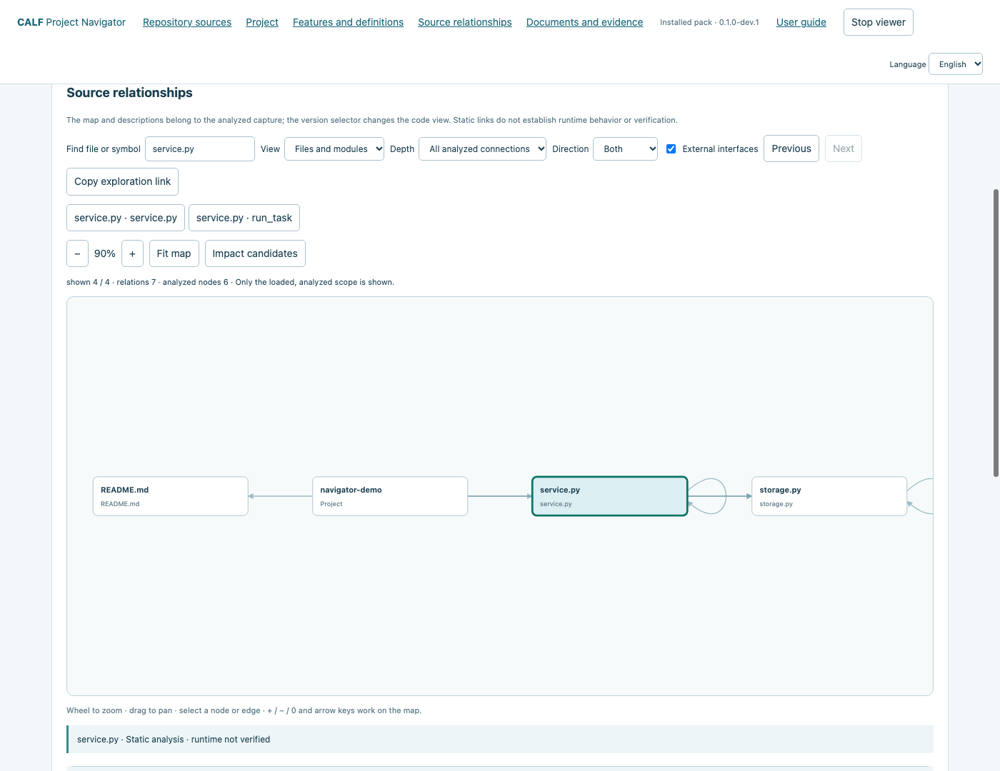
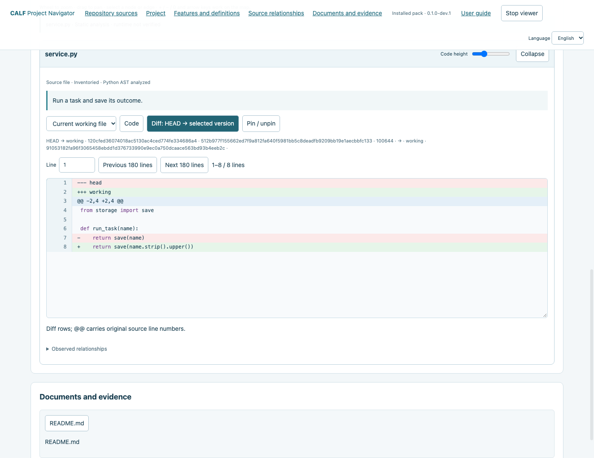
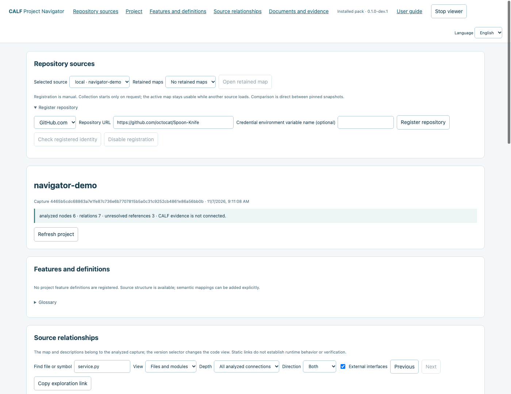
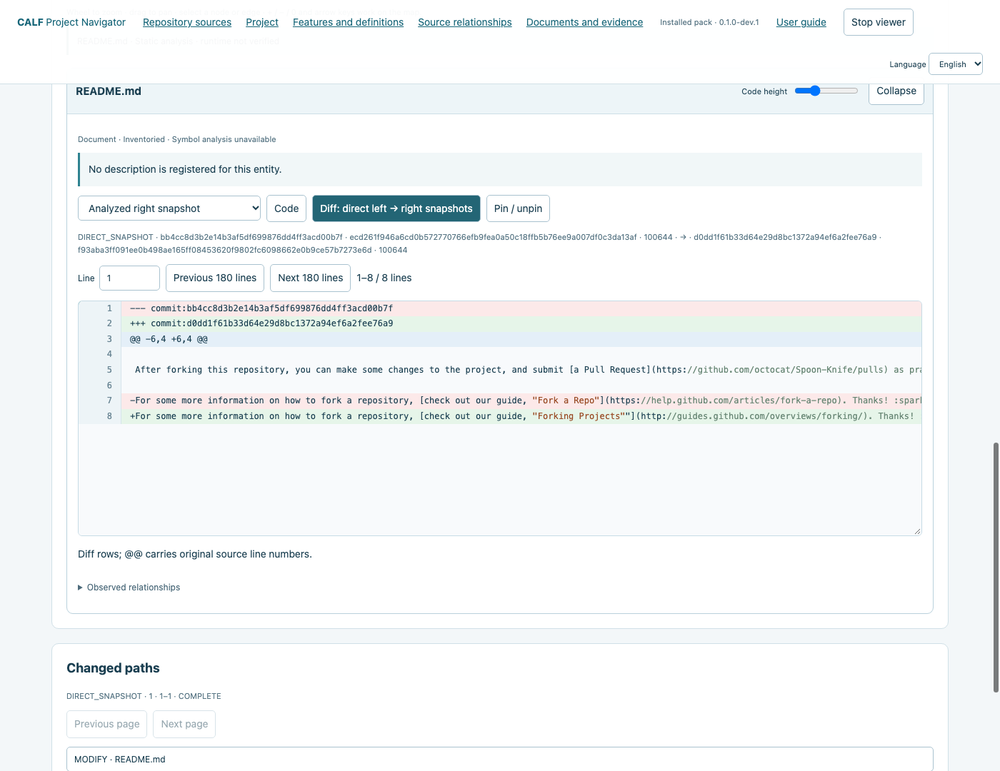
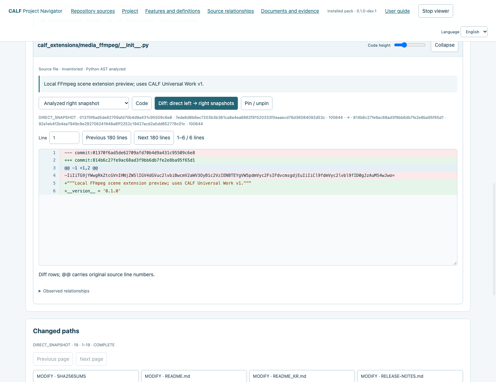
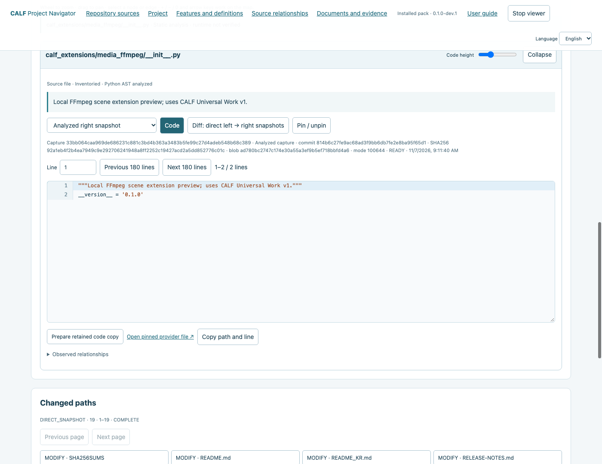

# Repository Navigator guide

[한국어](README_KR.md) · [Overview](../../README.md)

## Project navigation preview

[GitHub download](https://github.com/VibePakcr/CALF-Extensions/releases/tag/navigator-v0.1.0-dev.1) · [GitLab download](https://gitlab.com/vibepackr-group/CALF-Extensions/-/releases/navigator-v0.1.0-dev.1) · [English PDF - 9 pages](https://github.com/VibePakcr/CALF-Extensions/blob/main/docs/navigator-manual/en.pdf) · [한국어 PDF - 9쪽](https://gitlab.com/vibepackr-group/CALF-Extensions/-/blob/main/docs/navigator-manual/ko.pdf)

### Illustrated user manual

The steps below are the complete nine-chapter user guide, with real screenshots from the installed preview. Source content, commit IDs and graph counts can vary with the selected repository and capture.

#### 1. Install and start

One free installed extension connects Local Git, GitHub.com and GitLab.com to a relationship map with descriptions, code and Diff below it.

1. Prepare Python 3.10+, Git 2.43+ and a modern browser. CALF core, SDK and models are not required.
2. Extract the trusted download into a new folder. Verify its published SHA256 and read the included license notices.
3. Open a terminal in the extracted folder and run the commands below. On Windows use python instead of python3.

```sh
python3 START_NAVIGATOR.py install --home ../navigator-store --data-dir ../navigator-data --preview
python3 START_NAVIGATOR.py open --home ../navigator-store
```

Installation runs offline fixture checks and records exact Python/Git identities. The browser opens automatically; keep its terminal running. Use Stop viewer to finish.

STORE, DATA and inspected repositories must be separate. No account discovery, global tool installation or background service is added.

Optional: select executables with --python ABSOLUTE_PATH --git ABSOLUTE_PATH. To open the printed local URL yourself, add --no-browser to the open command.

#### 2. Attach Local Git and explore the map

1. Choose one existing worktree explicitly. Replace the example path with your actual project path.
2. Find a file or symbol, then select a node. Choose file/module or symbol view, incoming/outgoing/both, and depth 1/2/3/all analyzed connections.
3. Scroll the mouse wheel to zoom, drag empty space to pan, or use + / - / Fit map. Use Previous and Next to revisit earlier selections; Impact candidates traces links backward to show code that may be affected.

```sh
python3 START_NAVIGATOR.py open --home ../navigator-store --repo /path/to/project
```



Only analyzed scope is shown, up to 500 displayed nodes. Static links and impact candidates do not prove runtime behavior.

Python symbols/calls are analyzed. Other languages retain file/document structure with coverage gaps shown.

#### 3. Read code and compare versions

1. Select a node and read its description, source and identities in the inspector below the map.
2. For Local Git choose analyzed capture, HEAD, index or working file. Diff compares HEAD to the selected version. Conflict stages 1/2/3 are separate states.
3. Jump to a line, resize or collapse the code panel, and pin a file for comparison. Long lines scroll horizontally. Interface language changes do not translate source, comments or user definitions.



The navigator does not commit, checkout or alter source. A Local Git editor link opens its selected file path. Editing a working file in that editor changes the project; check path and version first.

#### 4. Register a GitHub repository

1. Expand Register repository, choose GitHub.com and enter https://github.com/octocat/Spoon-Knife or your own repository URL.
2. For public anonymous access leave the credential reference blank. Register, then Check registered identity. Registration is local and does not start collection.
3. Choose branch/tag/full commit and its exact name. This example uses branch + main. Choose a left ref or keep first parent/empty baseline, then Collect and analyze.



Anonymous API quotas apply. A limit, timeout or missing object can leave a partial result; this is not complete coverage. Cancel collection preserves the current map.

#### 5. Inspect pinned remote code and Diff

1. Select a file in the map, search results or Changed paths after collection.
2. For remote sources, choose analyzed right, comparison left or comparison right. Diff compares the pinned snapshots directly, not a working tree or merge base.
3. Read commit, blob and SHA256 identities. Open pinned provider file links to that commit. No remote branch or file is changed.



Absent files, empty files and unavailable source are distinct. Missing retained bytes are not presented as empty content.

#### 6. Use the same workflow with GitLab

1. Choose GitLab.com in Register repository. Public example: https://gitlab.com/vibepackr-group/CALF-Extensions
2. Register and check the project identity, then choose branch + main and Collect and analyze. Nested project namespaces are supported.
3. Map, source, direct Diff, changed paths and retained views use the same controls. Reads remain pinned to the resolved GitLab commit.



This preview targets GitHub.com and GitLab.com. Self-hosted servers and private-account behavior are not qualified by these public examples.

#### 7. Retained maps, definitions and editor copies

1. Choose a source, a Retained maps entry, then Open retained map. Reopening retained bytes does not re-collect a moving branch. Partial results require explicit selection.
2. For hosted source choose Code, then Prepare retained code copy. Its editor link points to a separate copy, not the cached original or remote file. VS Code needs a configured local URL handler.
3. Use an explicit UTF-8 --project-map CONFIG_FILE for feature definitions, glossary terms, code targets and document references. See the included repository guide for its JSON format. Missing targets remain unresolved.



Copy exploration link retains navigation state for this capture. Previous/Next and file pinning help compare related code. Source language remains original.

#### 8. Offline export and credential references

Stop the viewer and copy BINDING from its printed result. List sources; collect an explicit ref for SOURCE_ID, then copy CONTEXT_ID from that collection result. Replace the capitalized placeholders.

```sh
python3 START_NAVIGATOR.py run --binding BINDING -- sources list
python3 START_NAVIGATOR.py run --binding BINDING -- scan --source SOURCE_ID --ref-kind branch --ref main
python3 START_NAVIGATOR.py run --binding BINDING -- export --view CONTEXT_ID --output ../project-offline --include-source
```

Omit --include-source for a structural export without source. Origin details require the separate --include-origin option. Review code and provenance before sharing. Open START_HERE.html inside the output folder. Offline pages do not register/collect or open live editor/provider actions.

For an existing read-only credential, set it in your own process environment and pass only its variable name:

```sh
python3 START_NAVIGATOR.py open --home ../navigator-store --credential-env MY_READ_TOKEN
```

Enter MY_READ_TOKEN in the registration reference field too. Its value travels to the worker through a pipe and is not retained in launch receipts. Never put values in URLs or commands.

This bundle does not import gh CLI authentication. Anonymous public access works without a credential. Private-account qualification remains pending.

#### 9. Stop, update, recover and troubleshoot

Stop viewer closes the foreground server and its collection jobs. Close the tab afterward. Reopen with the original command. If the workspace is busy, finish its existing session first. Keep the extracted bundle folder for its manuals.

```sh
python3 START_NAVIGATOR.py status --home ../navigator-store
python3 START_NAVIGATOR.py install --home ../navigator-store --data-dir ../navigator-data --preview --expected-active CURRENT_DIGEST
python3 START_NAVIGATOR.py rollback --home ../navigator-store --lock OLD_LOCK --expected-active CURRENT_DIGEST --preview
```

Run install from the new trusted bundle. Keep the same store/data and install-time --repo selection, if used. CURRENT_DIGEST comes from status; OLD_LOCK comes from the retained installation result.

Old bindings retain their original version. A new open from --home binds the active version. Updates do not migrate or erase old packs, captures, receipts or bindings.

| Symptom | Action |
| --- | --- |
| Integrity/dependency mismatch | Use a trusted fresh extraction and re-qualify exact dependencies; retain old results. |
| Partial/unavailable source | Inspect coverage; a limit or missing object does not prove absence. |
| Provider quota/authentication error | Wait for reset or use a suitable credential reference. |
| No symbols/features | Python symbol analysis and explicit semantic mappings are separate from file structure. |
| Editor does not open | Check the selected path and local URL handler; code view still works. |

Preview limits: 1 MiB/file, 64 MiB retained-source budget, 300 requests/120 seconds per hosted collection.

Installation and CLI workflows were tested on macOS, Debian and Windows. Screenshots/current browser flows use macOS Chrome. Physical mobile, native editor, private-account and self-hosted behavior are not qualified.

The ZIP includes offline HTML guides at `manuals/en.html` and `manuals/ko.html`.

[Installation / recovery](../NAVIGATOR_PACK.md) · [Feature/glossary mapping JSON](../REPOSITORY_NAVIGATOR.md) · [Installed qualification and limits](../NAVIGATOR_PACK_VERIFICATION.json) · [H5 qualification](../REPOSITORY_HOSTED_H5.md)
