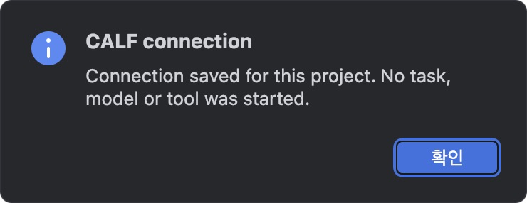

# Install CALF Connect

[한국어](INSTALL_KR.md) · [Start](README.md) · [Illustrated manual](MANUAL.md)

CALF Connect adds four commands to your IDE. You can open Workbench and read its work attention without finding the terminal command each time. It uses your existing CALF installation. It does not submit an AI task.

## 1. Download

Keep your existing CALF installation, records and older versions. If CALF is not installed, first use the [official Workbench downloads](https://github.com/VibePakcr/CALF/blob/main/DOWNLOADS.md).

| Your IDE | File |
| --- | --- |
| VS Code, Cursor, Antigravity **IDE** | [CALF-Connect-0.1.0-dev.1.vsix](https://github.com/VibePakcr/CALF-Extensions/releases/download/connect-v0.1.0-dev.1/CALF-Connect-0.1.0-dev.1.vsix) |
| PyCharm 2026.3 | [CALF-Connect-0.1.0-dev.1-pycharm.zip](https://github.com/VibePakcr/CALF-Extensions/releases/download/connect-v0.1.0-dev.1/CALF-Connect-0.1.0-dev.1-pycharm.zip) |

[GitHub release and checksums](https://github.com/VibePakcr/CALF-Extensions/releases/tag/connect-v0.1.0-dev.1) · [GitLab release](https://gitlab.com/vibepackr-group/CALF-Extensions/-/releases/connect-v0.1.0-dev.1)

Compare the downloaded file's SHA-256 with the release's `SHA256SUMS`. This is a development preview distributed as local installation files; no marketplace account is needed. Keep the PyCharm ZIP intact.

## 2. Install in your IDE

**VS Code / Cursor / Antigravity IDE:** open Extensions (`Cmd+Shift+X` on Mac, `Ctrl+Shift+X` on Windows/Linux), open its **…** menu, choose **Install from VSIX…**, and select the VSIX. Reload the IDE if prompted. Antigravity IDE is the editor application; the standalone Antigravity agent application is a different product.

**PyCharm:** open Settings → Plugins → gear menu → **Install Plugin from Disk…**, select the ZIP and restart if prompted. This adapter uses IntelliJ platform APIs; other JetBrains products have not been qualified.

Install into the profile you intend to use. A separate test or portable profile has its own extension list. Installing into one profile does not prove installation in another.

## 3. Connect one project

Open a project folder you trust. Open the command palette (`Cmd+Shift+P` / `Ctrl+Shift+P`), type `CALF`, and choose **CALF: Configure this workspace connection**. In PyCharm use **Tools → CALF → Configure workspace connection**.

Select these three existing locations in order:

| Selection | What to select |
| --- | --- |
| CALF native core | The `calf` executable bundled with Workbench; `calf.exe` on Windows |
| Records folder | The same records folder already used by your Workbench |
| Workbench executable | `calf-terminal`; `calf-terminal.exe` on Windows |

On macOS, both executables are inside **CALF Workbench.app → Contents → MacOS**. In Finder, use **Show Package Contents**; in a file dialog, `Cmd+Shift+G` lets you enter the full executable path. Select the executable, not the `.app` directory. On Windows/Linux, the two executables are in the extracted Workbench folder. PyCharm asks for their absolute paths in text dialogs.

**The records folder is different from your code project folder.** Standard distribution defaults are:

| OS | Default records folder |
| --- | --- |
| macOS | `~/Library/Application Support/CALF/workbench` |
| Windows | `%LOCALAPPDATA%\CALF\workbench` |
| Linux | `${XDG_DATA_HOME}/calf/workbench`, or `~/.local/share/calf/workbench` when unset |

If your launcher uses a custom records location, choose that existing location instead. A development Workbench with a neighboring `runtime.json` uses the home specified by that runtime; choose the same home. Do not move records or edit the runtime merely to connect the plugin.

## 4. Confirm the connection

Run **Read work attention**. It should display a native response containing `"readOnly": true` and `"completionEvaluated": false`. An empty attention list is normal for empty records; it does not certify completed work.

Then run **Open Workbench**. Check that Workbench opens with your intended records. Use **Choose workspace** there when you want to select a code folder. This connector does not automatically submit a task or transfer an IDE conversation.

## Updates and troubleshooting

- **No CALF commands:** confirm that you installed into this IDE profile, reload the project, and check the Extensions/Plugins list. Open the actual editor window in Cursor or Antigravity IDE.
- **Configure first:** configure this project; another project's saved connection is separate.
- **Connection identity changed:** a selected executable has changed. Keep old runtimes referenced by existing tasks, then explicitly choose the intended connection again. No replacement is made automatically.
- **Workbench opens a different history:** check its existing runtime/launcher home and reconnect to that same records folder. Do not copy or delete histories to make them match.
- **Read attention fails:** inspect CALF's existing records and installation. The connector does not automatically retry, approve or recover work.
- **MCP:** **Copy read-only MCP server entry** only copies a descriptor. Add it through your AI client's supported settings. It does not configure the client or enable control tools.

The [manual](MANUAL.md) includes actual Windows/Linux/macOS screens and the exact qualification scope.
