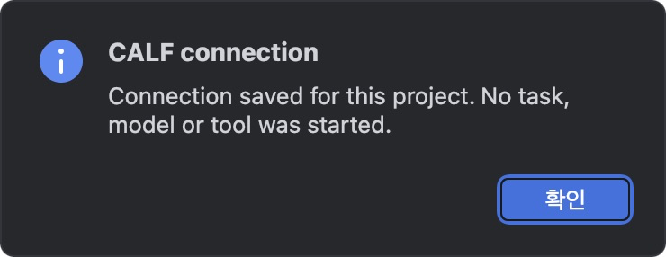

# CALF Connect 설치

[English](INSTALL.md) · [처음으로](README_KR.md) · [화면 매뉴얼](MANUAL_KR.md)

CALF Connect는 IDE에 네 가지 명령을 추가합니다. 매번 터미널 명령을 찾지 않고 Workbench를 열고 작업 주의 목록을 읽을 수 있습니다. 기존 CALF를 사용하며 AI 작업을 자동 제출하지 않습니다.

## 1. 다운로드

기존 CALF 설치본·기록·이전 버전은 그대로 보관하세요. CALF가 없다면 먼저 [공식 Workbench 다운로드](https://github.com/VibePakcr/CALF/blob/main/DOWNLOADS.md)를 이용합니다.

| 사용하는 IDE | 받을 파일 |
| --- | --- |
| VS Code·Cursor·Antigravity **IDE** | [CALF-Connect-0.1.0-dev.1.vsix](https://github.com/VibePakcr/CALF-Extensions/releases/download/connect-v0.1.0-dev.1/CALF-Connect-0.1.0-dev.1.vsix) |
| PyCharm 2026.3 | [CALF-Connect-0.1.0-dev.1-pycharm.zip](https://github.com/VibePakcr/CALF-Extensions/releases/download/connect-v0.1.0-dev.1/CALF-Connect-0.1.0-dev.1-pycharm.zip) |

[GitHub 릴리즈·체크섬](https://github.com/VibePakcr/CALF-Extensions/releases/tag/connect-v0.1.0-dev.1) · [GitLab 릴리즈](https://gitlab.com/vibepackr-group/CALF-Extensions/-/releases/connect-v0.1.0-dev.1)

다운로드 파일의 SHA-256을 릴리즈의 `SHA256SUMS`와 대조하세요. 직접 설치하는 개발 프리뷰이며 마켓플레이스 계정은 필요하지 않습니다. PyCharm ZIP은 풀지 마세요.

## 2. IDE에 설치

**VS Code·Cursor·Antigravity IDE:** 확장 화면을 열고(Mac `Cmd+Shift+X`, Windows/Linux `Ctrl+Shift+X`), `… → Install from VSIX…`에서 VSIX를 선택합니다. 다시 로드하라는 안내가 나오면 따릅니다. Antigravity IDE는 편집기 앱이며 별도의 Antigravity 에이전트 앱과 구분해야 합니다.

**PyCharm:** Settings → Plugins → 톱니바퀴 → `Install Plugin from Disk…`에서 ZIP을 선택하고, 안내가 나오면 재시작합니다. IntelliJ 공통 API를 사용하지만 다른 JetBrains 제품은 검증하지 않았습니다.

실제로 사용할 IDE 프로필에 설치하세요. 시험·포터블 프로필은 확장 목록이 별도이므로 다른 프로필에 설치됐다는 사실만으로 현재 창의 설치를 확인할 수 없습니다.

## 3. 프로젝트 하나 연결

신뢰하는 프로젝트 폴더를 열고 명령 팔레트(Mac `Cmd+Shift+P`, Windows/Linux `Ctrl+Shift+P`)에서 `CALF`를 검색한 뒤 **CALF: Configure this workspace connection**을 선택합니다. PyCharm에서는 **도구/Tools → CALF → Configure workspace connection**입니다.

다음 세 위치를 순서대로 선택하세요.

| 선택 항목 | 고를 대상 |
| --- | --- |
| CALF 네이티브 코어 | Workbench와 함께 있는 `calf` 실행 파일. Windows는 `calf.exe` |
| 기록 폴더 | 기존 Workbench가 사용하는 바로 그 기록 폴더 |
| Workbench 실행 파일 | `calf-terminal`. Windows는 `calf-terminal.exe` |

macOS 실행 파일은 **CALF Workbench.app → Contents → MacOS** 안에 있습니다. Finder의 **패키지 내용 보기**로 찾거나 파일 선택창에서 `Cmd+Shift+G`로 전체 실행 파일 경로를 입력하세요. `.app` 폴더 자체를 고르면 안 됩니다. Windows/Linux에서는 압축을 푼 Workbench 폴더 안의 실행 파일을 고릅니다. PyCharm은 텍스트 입력창에 절대 경로를 넣습니다.

**기록 폴더와 코드를 작성하는 프로젝트 폴더는 다릅니다.** 일반 배포판의 기본 기록 위치는 다음과 같습니다.

| OS | 기본 기록 위치 |
| --- | --- |
| macOS | `~/Library/Application Support/CALF/workbench` |
| Windows | `%LOCALAPPDATA%\CALF\workbench` |
| Linux | `${XDG_DATA_HOME}/calf/workbench`. 설정하지 않았다면 `~/.local/share/calf/workbench` |

기존 실행기가 사용자 지정 기록 위치를 사용한다면 그 위치를 선택하세요. 실행 파일 옆에 `runtime.json`이 있는 개발용 Workbench는 해당 런타임에 지정된 기록 위치를 사용하므로 같은 위치를 고릅니다. 연결을 위해 기록을 이동하거나 런타임 설정을 고치지 마세요.

## 4. 연결 확인

**Read work attention**을 실행하세요. 네이티브 응답에 `"readOnly": true`와 `"completionEvaluated": false`가 표시되는지 확인합니다. 빈 기록에서는 주의 목록이 비어 있어도 정상이며 작업 완료를 인증한 것은 아닙니다.

이어서 **Open Workbench**를 실행하고 의도한 기록으로 열렸는지 확인하세요. 작업할 코드 폴더는 Workbench의 **Choose workspace**에서 선택합니다. IDE 대화를 자동 전송하거나 작업을 제출하는 기능은 아닙니다.

## 업데이트·문제 해결

- **CALF 명령이 없음:** 현재 IDE 프로필에 설치했는지 확장/플러그인 목록을 확인하고 프로젝트를 다시 여세요. Cursor·Antigravity IDE는 실제 편집기 창에서 확인합니다.
- **Configure first:** 이 프로젝트의 연결을 설정하세요. 다른 프로젝트의 설정과 별도입니다.
- **Connection identity changed:** 선택한 실행 파일이 바뀐 상태입니다. 기존 작업이 참조하는 이전 런타임은 보관하고, 의도한 연결을 직접 다시 지정하세요. 자동 대체하지 않습니다.
- **다른 기록으로 열림:** 기존 런타임·실행기의 기록 위치를 확인하고 같은 폴더로 다시 연결하세요. 맞추기 위해 기록을 복사하거나 삭제하지 마세요.
- **주의 목록 조회 실패:** 기존 CALF 기록과 설치 상태를 확인하세요. 플러그인이 자동으로 재시도·승인·복구하지 않습니다.
- **MCP:** **Copy read-only MCP server entry**는 연결 항목만 복사합니다. 사용하는 AI 클라이언트의 지원 설정 절차로 넣으세요. 클라이언트를 자동 설정하거나 제어 도구를 켜지 않습니다.

[매뉴얼](MANUAL_KR.md)에서 세 OS의 실제 화면과 정확한 검증 범위를 확인할 수 있습니다.
