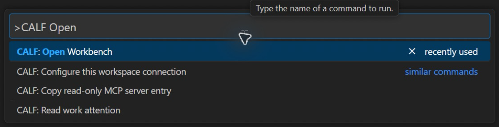
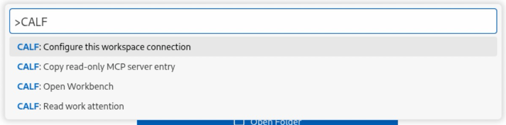
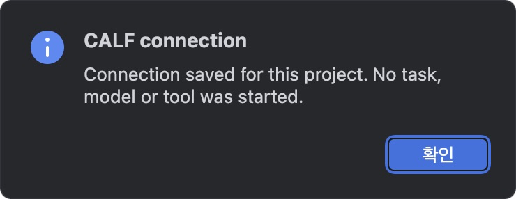
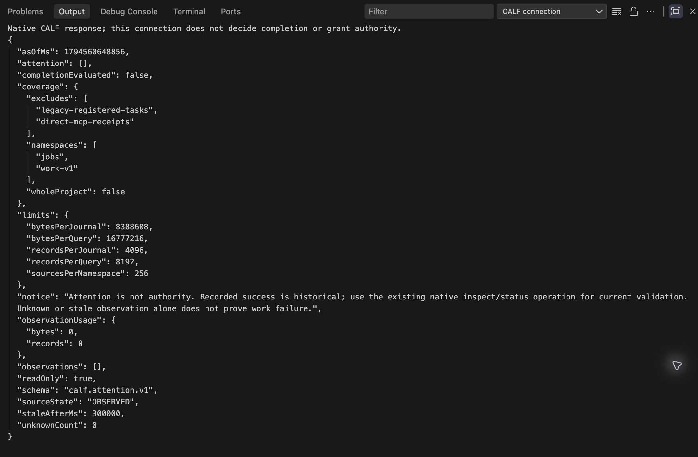
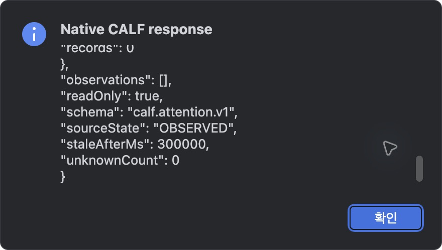
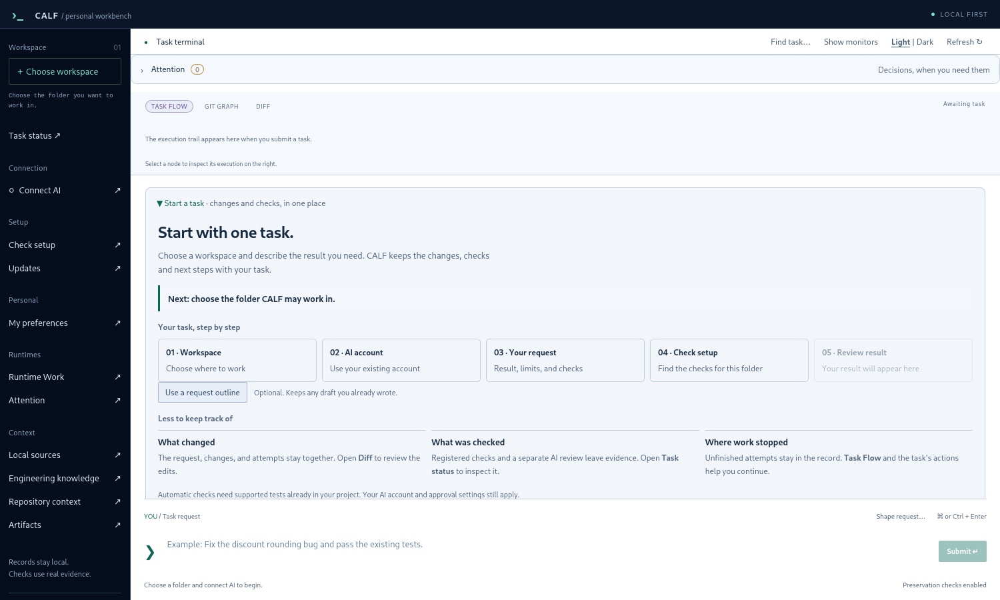

# CALF Connect manual

[한국어](MANUAL_KR.md) · [Installation](INSTALL.md) · [Start](README.md)

Connect the project once, then use the same four commands from your IDE. CALF's native runtime continues to own work state, checks, approval and recovery.

## The four commands

| Command | Result |
| --- | --- |
| Configure this workspace connection | Save three selected paths and executable hashes in this IDE project's state |
| Read work attention | Display the native read-only response |
| Open Workbench | Request a Workbench window using the selected records home; check the opened runtime's configured home |
| Copy read-only MCP server entry | Copy the existing foreground stdio server descriptor, without `--control` |

The VS Code-family frontend is one common VSIX. PyCharm has a thin IntelliJ platform adapter. No task is submitted when an extension activates, a connection is saved or a Workbench window opens.

## Find the command in your editor

**macOS · Antigravity IDE:** use `Cmd+Shift+P` and search for `CALF`.

**Windows:** use `Ctrl+Shift+P`. This actual Antigravity IDE capture shows the same common commands.

**Linux:** use `Ctrl+Shift+P` in the IDE window. The same VSIX is used.

**PyCharm:** open **Tools → CALF** (도구 → CALF in the Korean UI). Enter the core, records and Workbench executable paths when configuring. A successful configuration gives this confirmation:

Follow [Installation, step 3](INSTALL.md#3-connect-one-project) to distinguish executables, records and the code project. Existing records and settings remain in their original locations.

## Understand the response

**Read work attention** displays CALF's native response. `readOnly: true` describes the query; `completionEvaluated: false` means it has not decided task completion. `coverage` states what was observed. An empty list does not prove all your work is complete.

PyCharm displays the same response in a scrollable dialog:

Use Workbench's existing task inspection to review evidence and take the required human action. A high attention priority never grants execution or approval permission.

## Open Workbench

These are real Workbench 1.9.16 windows opened during qualification with separate empty records. They show **Awaiting task**; no completed task or AI run is implied. Select a workspace and connect your AI through Workbench when you actually want to start work.

**macOS**

**Windows 11 x64**

**Debian 13 x64**

## What was qualified

On 2026-11-13, actual computer-use checks covered **12 IDE/OS combinations**: VS Code, Cursor, PyCharm and Antigravity IDE on macOS, Windows and Debian. Each flow showed the commands, configured a project through real dialogs, displayed native attention with `readOnly: true` / `completionEvaluated: false`, and opened a Workbench window.

| IDE | macOS | Windows | Debian |
| --- | --- | --- | --- |
| VS Code | 1.146.0 | 1.146.0 | 1.145.2 |
| Cursor | 3.30.8 | 3.30.8 | 3.30.8 |
| PyCharm | 2026.3 | 2026.3 | 2026.3 |
| Antigravity IDE | 2.6.0 / VS Code API 1.107.0 | VS Code API 1.107.0 | VS Code API 1.107.0 |

PyCharm also retained its connection across a normal macOS quit/restart. Cursor qualification used an open test project; empty-window behavior is not claimed. Other JetBrains products, other Linux distributions, new AI task completion, client-specific MCP setup, production acceptance and token savings are outside these tests.

Screens are actual captures from isolated profiles. Published crops omit connection chrome, account screens and unrelated desktop content. Application pixels were not repainted. The optional monitors were hidden through Workbench's real UI for the final overview captures.

Screens were refreshed from Workbench 1.9.16 release executables on all three OS. The 12 IDE menu/configuration/read/launch flows reuse qualification of the unchanged connector runtime.
