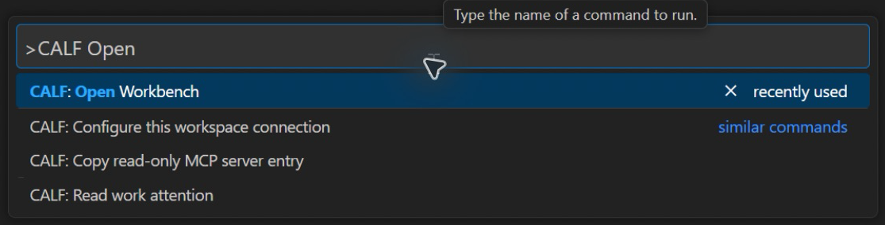
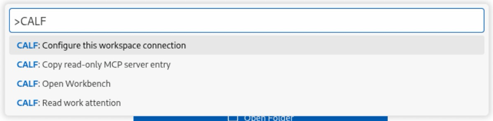
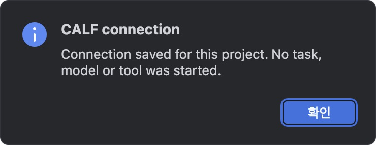
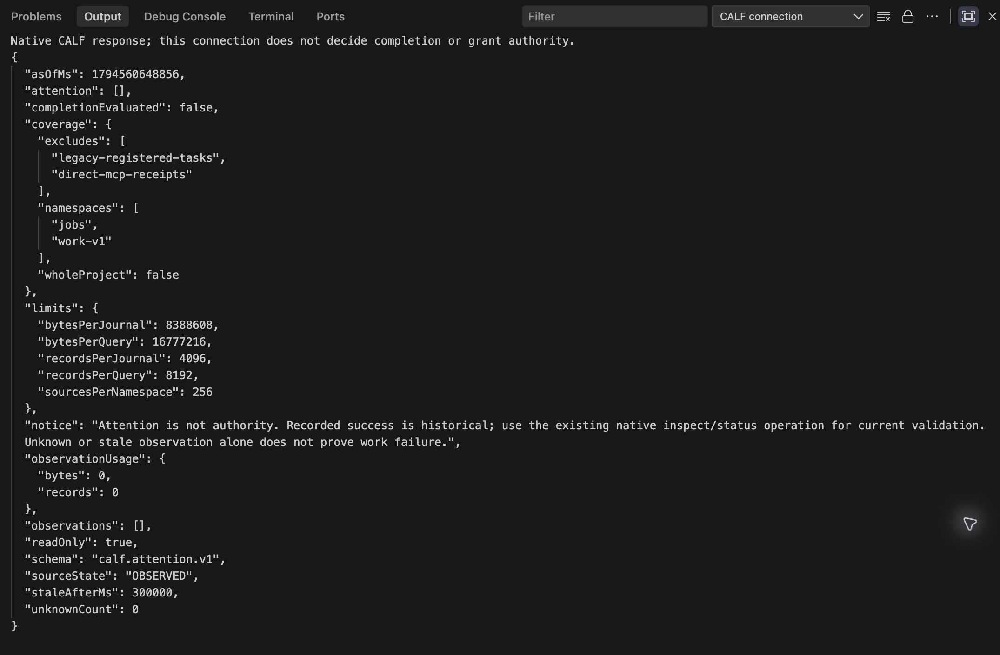
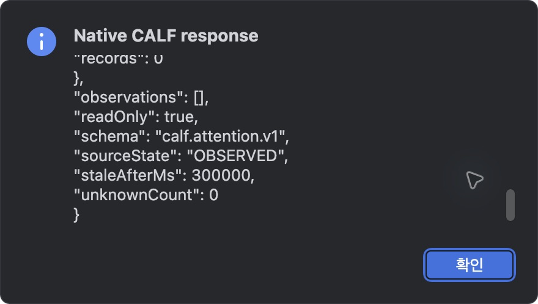
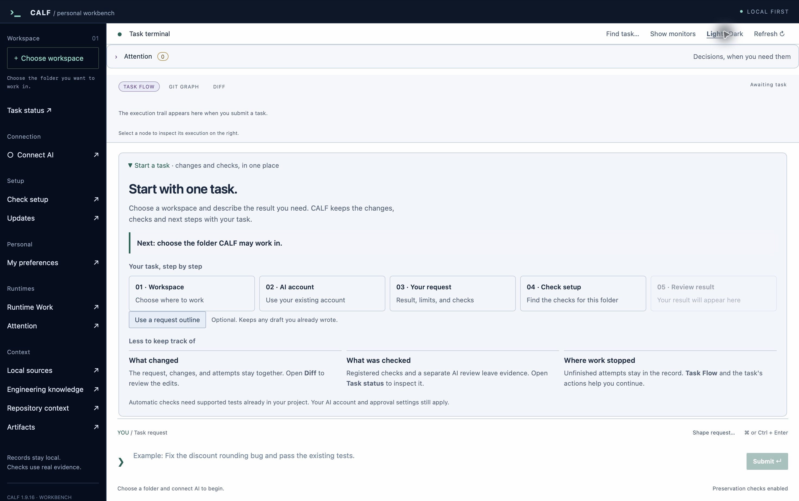
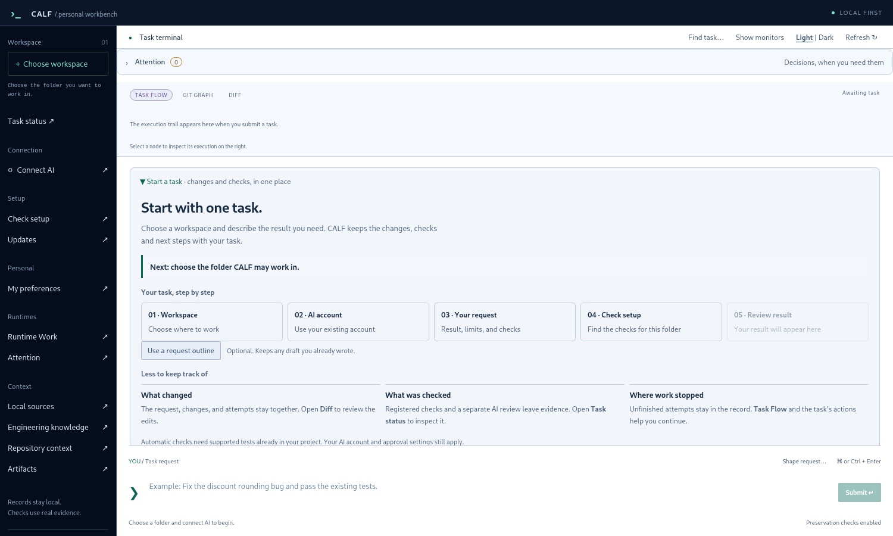

# CALF Connect 화면 매뉴얼

[English](MANUAL.md) · [설치 안내](INSTALL_KR.md) · [처음으로](README_KR.md)

프로젝트를 한 번 연결하면 IDE에서 같은 네 명령을 사용합니다. 작업 상태·검사·승인·복구는 기존 CALF 네이티브 런타임이 담당합니다.

## 네 가지 명령

| 명령 | 하는 일 |
| --- | --- |
| Configure this workspace connection | 선택한 세 경로와 실행 파일 해시를 해당 IDE 프로젝트 상태에 저장 |
| Read work attention | 네이티브 읽기 전용 응답 표시 |
| Open Workbench | 선택한 기록 위치로 Workbench 창 실행 요청. 열린 런타임의 기록 설정도 확인 |
| Copy read-only MCP server entry | `--control` 없이 기존 포그라운드 stdio 서버 연결 항목 복사 |

VS Code 계열은 공통 VSIX 하나를 쓰며 PyCharm은 IntelliJ 공통 API를 쓰는 얇은 어댑터입니다. 확장 활성화·연결 저장·Workbench 창 실행만으로 작업을 제출하지 않습니다.

## 편집기에서 명령 찾기

**macOS·Antigravity IDE:** `Cmd+Shift+P`를 누르고 `CALF`를 검색합니다.

**Windows:** `Ctrl+Shift+P`를 누릅니다. 실제 Antigravity IDE 캡처에도 같은 공통 명령이 표시됩니다.

**Linux:** IDE 편집기 창에서 `Ctrl+Shift+P`를 누릅니다. 같은 VSIX를 사용합니다.

**PyCharm:** **도구/Tools → CALF**를 엽니다. 연결 설정에서 코어·기록·Workbench 실행 파일의 경로를 입력합니다. 저장되면 다음 확인창이 표시됩니다.

실행 파일·기록·코드 프로젝트를 구분하는 방법은 [설치 안내 3단계](INSTALL_KR.md#3-프로젝트-하나-연결)를 확인하세요. 기존 기록과 설정은 원래 위치에 보관합니다.

## 응답 읽기

**Read work attention**은 CALF의 네이티브 응답을 표시합니다. `readOnly: true`는 읽기 전용 조회라는 뜻이며 `completionEvaluated: false`는 작업 완료를 판정하지 않았다는 뜻입니다. `coverage`에서 관측 범위를 확인할 수 있습니다. 빈 목록이 모든 작업의 완료를 뜻하지는 않습니다.

PyCharm은 같은 응답을 스크롤 가능한 확인창으로 표시합니다.

기존 Workbench의 작업 검사에서 근거와 필요한 사람의 조치를 확인하세요. 주의 우선순위가 높아도 실행·승인 권한이 새로 생기지 않습니다.

## Workbench 열기

아래는 분리된 빈 기록으로 실제 실행한 **Workbench 1.9.16** 화면입니다. **Awaiting task** 상태이며 작업 완료나 AI 실행을 보여주는 화면은 아닙니다. 실제 작업을 시작할 때 Workbench에서 작업 폴더와 AI 연결을 선택합니다.

**macOS**

**Windows 11 x64**

**Debian 13 x64**

## 검증 범위

2026-11-13 실제 computer use로 macOS·Windows·Debian의 VS Code·Cursor·PyCharm·Antigravity IDE, **12개 조합**을 확인했습니다. 각 조합에서 명령 표시 → 실제 대화상자로 프로젝트 연결 → `readOnly: true`·`completionEvaluated: false` 네이티브 응답 → 실제 Workbench 창 실행을 확인했습니다.

| IDE | macOS | Windows | Debian |
| --- | --- | --- | --- |
| VS Code | 1.146.0 | 1.146.0 | 1.145.2 |
| Cursor | 3.30.8 | 3.30.8 | 3.30.8 |
| PyCharm | 2026.3 | 2026.3 | 2026.3 |
| Antigravity IDE | 2.6.0 / VS Code API 1.107.0 | VS Code API 1.107.0 | VS Code API 1.107.0 |

PyCharm은 macOS에서 정상 종료·재시작 후 연결 재사용도 확인했습니다. Cursor는 시험 프로젝트를 연 상태에서 검증했으며 빈 창 동작은 주장하지 않습니다. 다른 JetBrains 제품·Linux 배포판·새 AI 작업 완료·클라이언트별 MCP 설정·운영 수락·토큰 절감률은 이번 검사 범위가 아닙니다.

화면은 분리 프로필에서 실제로 캡처했습니다. 공개용 영역에는 원격 접속 도구·인증 화면·무관한 데스크톱 내용을 넣지 않았으며 앱의 픽셀을 다시 그리지 않았습니다. 최종 개요 화면의 모니터 패널은 실제 Workbench UI에서 숨겼습니다.

화면은 세 OS의 Workbench 1.9.16 배포 실행 파일에서 갱신했습니다. IDE 메뉴·설정·조회·호출의 12개 조합 검증은 변경되지 않은 연결 런타임의 기존 근거를 재사용합니다.
