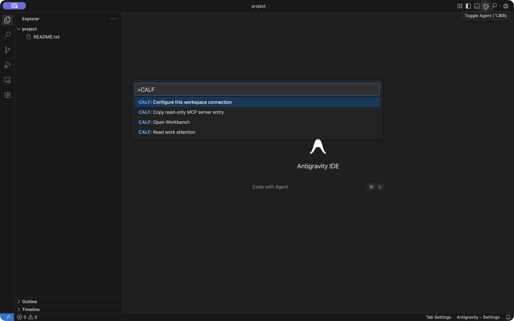

# CALF Connect · 0.1.0-dev.1

[한국어](README_KR.md) · **[Install first](INSTALL.md)** · [Illustrated manual](MANUAL.md) · [Qualification](QUALIFICATION.json)

Open CALF Workbench and read work attention from the IDE you already use. Choose the connection once per project; use the same commands when you return.

One common VSIX supports VS Code, Cursor and Antigravity IDE. PyCharm uses a separate IntelliJ platform adapter with the same transport definition. Actual menu → configuration → native attention → Workbench flows were checked in separate profiles on **macOS, Windows and Debian: 12 combinations**.



## Download and connect

[GitHub release](https://github.com/VibePakcr/CALF-Extensions/releases/tag/connect-v0.1.0-dev.1) · [GitLab release](https://gitlab.com/vibepackr-group/CALF-Extensions/-/releases/connect-v0.1.0-dev.1)

Install the VSIX in a VS Code-family editor, or the PyCharm ZIP through **Plugins → Install Plugin from Disk…**. Open a project, run **Configure this workspace connection**, and select the existing CALF core, records folder and Workbench executable. [The installation guide](INSTALL.md) explains each selection and the OS paths.

| Command | Use it for |
| --- | --- |
| Configure this workspace connection | Save this project's connection explicitly |
| Read work attention | See the native read-only response |
| Open Workbench | Open the existing Workbench |
| Copy read-only MCP server entry | Copy a descriptor for a compatible client's own setup |

The connector does not submit tasks, call a model, approve work, alter contracts or decide completion. No server starts when it activates. A Workbench launch is a launch request; the manual explains how to check the opened records location. No token-saving percentage is claimed.

## Qualification

The [manual](MANUAL.md#what-was-qualified) lists tested IDE versions and actual screens. Native JavaScript transport tests and the Java probe also check literal Unicode paths, bounded responses, unchanged executable identity, read-only behavior and the absence of a control flag. PyCharm retained its connection across a normal macOS restart.

This is an unsigned development preview for local installation, not a marketplace listing or production acceptance. Other JetBrains products and Cursor empty-window behavior are not qualified. Existing records, contracts, settings and older runtimes remain separate; keep them while existing work references them.

## Development

The native API remains the work decision owner. The builder uses the existing Node runtime and the installed macOS PyCharm JDK/API jars; it downloads no dependency and bundles no IDE, Gson or proprietary CALF core.

```sh
CALF_IDE_TEST_CORE=/absolute/calf python3 ide-connect/tools/build.py
```

Follow your project's build/output rules. External builds can choose an output root using `VIBEPACKR_T9_BUILD`. [License notice](LICENSE.txt).
